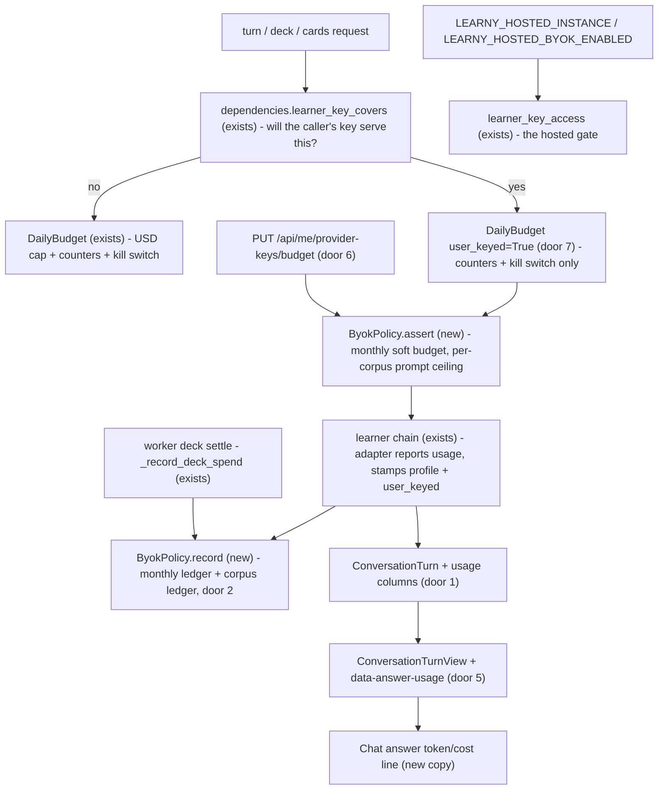
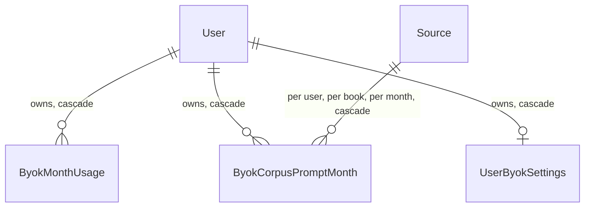

# Bring-your-own-key hosted policy

**Approved**: 2026-10-29 - user: "Go autonomously until completing everything"

## Problem

A learner can paste their own provider key today, but only on a self-host: the
recorded operator rule (ADR-0033 point 11) says a hosted public instance leaves
`LEARNY_SECRETS_KEK` unset until a policy exists. The rule is a sentence in an ADR,
not a mechanism — nothing in the code can tell a hosted instance from a private
VPS, so the only enforcement is an operator remembering a paragraph. What is
missing is the policy itself: which providers a hosted instance may accept keys
for, what a hosted learner is told about their key and their money, and which
house rails stop applying when the learner pays. Concretely, today:

- A learner whose own key serves a turn is still refused when the **house** daily
  USD cap trips (`assert_generation` reads the USD cap for every kind, whatever
  the payer) — their own money cannot be spent past a cap meant to protect the
  operator's wallet.
- Nobody, learner or operator, can see what a single answer cost: the usage the
  adapter reports debits the operator's ledger but never reaches the learner.
- Nothing bounds how much of one book a hosted learner can pump through their key
  (the relay/extraction risk the 2026-09-30 research raised), and nothing lets a
  learner cap their own monthly spend.
- The account keys section says keys are billed to the learner, but not which
  providers may train on the content (Google's unpaid Gemini tier does), and a
  hosted learner gets no disclosure that their key sits encrypted on someone
  else's server under their own provider agreement.

Evidence: `docs/research/2026-09-30/byok-and-business-models.md` (base_url CVEs
Lobe Chat GHSA-p36r-qxgx-jq2v and Open WebUI CVE-2024-7959; provider terms —
Anthropic permits customer keys billed to the owner, OpenAI's terms forbid key
transfer, Gemini's unpaid tier trains; the fixed-allow-list recommendation Q7
C5–C7, the per-corpus prompt-token cap C7, cost display + soft budget E9);
ROADMAP v8 row `byok-hosted-policy`; ADR-0033 point 11.

When this ships: an operator who declares an instance hosted and completes the
security-review checklist can flip one setting and offer learner keys on it —
Anthropic, OpenAI and Gemini-compat only, no learner-supplied endpoint, keys and
hosts staying exactly where the operator's profiles send them. A hosted learner
with a key sees every answer's tokens and its estimated cost on their key, sets
a monthly budget that pauses their own key when reached, reads per-provider
privacy badges and the hosted disclosure, and is never stopped by the house
wallet while still rate-limited and still bounded per book.

## Shape

Reuses the whole sealed-key machinery from the learner-keys cycle (envelope,
credential rows, learner chains, adapter cache, key routes) and the existing
spend ledger (`DailyBudget`, `ai_spend_days`); the new rules run in the
application layer beside `DailyBudget` (`app/application/byok.py`, new), wired
by the same web/worker composition roots, with the hosted gate added to the one
access point both assemblies already share.

1. `LEARNY_HOSTED_INSTANCE=true` + `LEARNY_HOSTED_BYOK_ENABLED=false` (defaults) -> `learner_key_access` (exists) - the one gate both the API and the worker resolve key access through; a hosted instance without the opt-in reads no credential row at all
2. `PUT /api/me/provider-keys/budget` -> `provider_keys` router (exists, extended) -> `UserByokSettings` row (door 6) - the learner's own soft monthly budget
3. a turn/deck/cards request -> `dependencies.py` (exists, extended) - `learner_key_covers` computes from the caller's credentials and the registry whether the learner's key will serve this call; the route passes it to the service
4. `PostConversationTurn` / `StartQuizGeneration` / `SuggestCards` (exist) - `DailyBudget.assert_generation(..., user_keyed=True)` skips the house USD cap only (door 7); `ByokPolicy` (new) asserts the monthly budget and the per-corpus prompt-token ceiling, then records the call's actual usage and estimated cost after success (door 2)
5. the adapter's reported usage -> `ConversationTurn` (exists, gains usage columns, door 1) -> `ConversationTurnView` + `data-answer-usage` stream part (door 5) -> the Chat answer line
6. `GET /api/me/provider-keys` (exists, extended) - reports `hosted` and the caller's month-to-date usage; the Account keys section renders badges, the hosted disclosure, and the budget control
7. worker deck settle -> `worker/tasks.py` `_record_deck_spend` (exists) - a learner-keyed deck pass records into the monthly and per-corpus ledgers beside the house 0-USD debit

**Changes underneath**

| Front | What changes |
| --- | --- |
| domain | `ConversationTurn` gains four optional fields (`usage_input_tokens`, `usage_output_tokens`, `cost_usd_micros`, `user_keyed`) — the turn's own record of what its call cost and who paid. Readers that branch on the turn today: `ConversationTurnView`, `ui_message_stream._terminal`, the frontend's restored-turn replay |
| application | `DailyBudget.assert_generation` gains a `user_keyed` keyword (callers that branch: `PostConversationTurn._preflight`, `StartQuizGeneration`); new `ByokPolicy` service over three new repositories; `usage_micros`'s user-keyed zeroing is unchanged, joined by `estimate_micros` which never zeroes (door 4) |
| stored data | migration adds three tables and four nullable/defaulted columns on `conversation_turns`; nothing to backfill — an existing row reads as "no usage reported", which is true |
| readers | the Account keys section (badges, hosted disclosure, usage + budget control), the Chat answer line (live stream + restored history), the operator's env examples and security checklist |

New: `ByokMonthUsage`, `ByokCorpusPromptMonth`, `UserByokSettings`, plus usage
columns on `conversation_turns`. One-way constraints: `(user_id, period_month)`
unique on `ByokMonthUsage`; `(user_id, source_id, period_month)` unique on
`ByokCorpusPromptMonth`; `user_id` primary key on `UserByokSettings` (door 2).

## Surface

| Route | In | Out | Status | Who |
| --- | --- | --- | --- | --- |
| `GET /api/me/provider-keys` | session | `enabled`, `hosted`, `providers[]` (unchanged shape), `usage` (`period`, `input_tokens`, `output_tokens`, `cost_usd_micros`, `budget_usd_micros` or null) | 200, 401 | authenticated learners; everyone else 401 |
| `PUT /api/me/provider-keys/budget` | `monthly_budget_usd` (number > 0 and ≤ 10000, or null to clear), CSRF header | the `usage` view | 200, 401, 403, 404, 422, 429 | authenticated learners; everyone else 401; feature off 404 |
| `POST /api/conversations/{id}/turns` | unchanged in; response gains `usage_input_tokens`, `usage_output_tokens`, `cost_usd_micros`, `user_keyed`; new refusal 429 with code `byok_budget` or `byok_corpus_limit` when the learner's key would serve | see prior column | 201, 401, 403, 404, 409, 422, 429, 502 | authenticated owners; unchanged |
| `POST /api/conversations/{id}/turns/stream` | unchanged in; terminal frames gain a `data-answer-usage` part; same new typed 429 refusals pre-stream | see prior column | 200 (SSE), 401, 403, 404, 409, 422, 429, 502 | authenticated owners; unchanged |
| `POST /api/sources/{source_id}/quiz/deck` | unchanged in; new typed 429 refusals when the owner's key would serve and a rail trips | unchanged out | 202, 401, 403, 404, 409, 422, 429 | authenticated owners; unchanged |
| `POST /api/sources/{source_id}/cards/suggestions` | unchanged in; new typed 429 refusals when the owner's key would serve and a rail trips | unchanged out | 200, 401, 403, 404, 409, 422, 429 | authenticated owners; unchanged |

## Landing

| One-way door | Literal shape | Alternative rejected |
| --- | --- | --- |
| 1. per-answer usage on the turn row | migration `0032_byok_policy_ledgers` adds to `conversation_turns`: `usage_input_tokens INTEGER NULL`, `usage_output_tokens INTEGER NULL`, `cost_usd_micros BIGINT NULL`, `user_keyed BOOLEAN NOT NULL DEFAULT false`. Null tokens = the adapter reported nothing; null cost = a house-served turn (the learner pays nothing) | deriving per-answer cost from `ai_spend_days` at read time — the daily ledger aggregates and zeroes user-keyed calls, so it cannot answer "what did this answer cost, and on whose key" |
| 2. the two BYOK ledgers + the budget row | `byok_month_usage`: `user_id` FK cascade, `period_month TEXT` (`YYYY-MM`), `input_tokens BIGINT`, `output_tokens BIGINT`, `cost_usd_micros BIGINT`, PK `(user_id, period_month)`. `byok_corpus_prompt_months`: the same period column with `source_id` FK cascade and `input_tokens`, PK `(user_id, source_id, period_month)`. `user_byok_settings`: `user_id` PK FK cascade, `monthly_budget_usd_micros BIGINT NULL`. All upsert-increment, like `ai_spend_days` | one ledger keyed per day (the policy is monthly and per-book, not daily); the budget on `user_ai_preferences` (its `profile_id` is NOT NULL, so a budget row could not exist without a profile choice — weakening a live constraint to borrow a table) |
| 3. hosted declaration + opt-in | `LEARNY_HOSTED_INSTANCE` (bool, default false) declares this instance hosted; `LEARNY_HOSTED_BYOK_ENABLED` (bool, default false) is the post-security-review opt-in. The gate lives in `learner_key_access` — one gate for the API and the worker: hosted and not opted in reads as feature-off everywhere (no credential row is read, `GET` reports `enabled: false`, writes 404). Self-host behavior is byte-identical to today whatever the flags | a runtime heuristic (the code cannot tell a public host from a private VPS — ADR-0033 point 11's own conclusion); a single combined flag (loses the declaration the disclosure and checklist key off, and an operator who wants the declaration without keys yet cannot say it) |
| 4. the estimate rule | `DailyBudget.estimate_micros(usage, profile_id)` prices any reported usage at the serving profile's catalog **regardless of payer**; `usage_micros`'s user-keyed zeroing is untouched. The turn's persisted cost (user-keyed only) and the monthly ledger debit both use it | reusing `usage_micros` for the display — it returns 0 for exactly the calls whose cost the learner must see |
| 5. the stream part | terminal frame emits `data-answer-usage` with `{input_tokens, output_tokens, cost_usd_micros, user_keyed}` (cost null for house turns); `ConversationTurnView` carries the same four flat fields; the frontend replays them for restored history | folding usage into `data-answer-status` — a status-only part every live client already parses; a display concern would then ride a contract field older messages never carried |
| 6. typed refusal codes | the two new 429s carry a machine code beside the detail: `{"detail": "<copy>", "code": "byok_budget"}` and `"byok_corpus_limit"`; every other error body is unchanged | copy-only refusals — the frontend never renders backend `detail` (English leak), so a code must carry the distinction; a new status number — 429 is the semantically right one and already flows through the chat error path |
| 7. the exemption's exact boundary | `assert_generation(user_id, kind, *, user_keyed=False)` skips **only** the `usd_micros >= daily_cap` comparison when `user_keyed`; the kill switch, `ask`/`teach_start` counters, and the route rate limits run unchanged for every payer | exempting the integer caps too — they are rate limits against abuse, not spend, and the row's own invariant is that the exemption must not bypass them |

- Nothing else in this change is hard to reverse.

## Criteria

### S1: The hosted gate and the allow-list (P1)

An operator declares an instance hosted; without the explicit opt-in, learner
keys stay off exactly as they are today, and with it they run under the
fixed three-provider allow-list with no learner-supplied endpoint anywhere.

**Acceptance Criteria**

1. WHILE `LEARNY_HOSTED_INSTANCE` is true and `LEARNY_HOSTED_BYOK_ENABLED` is false, the system SHALL treat learner keys as off with a KEK set and profiles bound: `GET /api/me/provider-keys` answers `200 {"enabled": false, "providers": []}`, every key write route answers `404`, and the credential table is not read
2. WHEN both hosted flags are true and a KEK plus a bound profile exist THEN the keys surface SHALL serve exactly as a self-host's does, and `GET /api/me/provider-keys` SHALL report `hosted: true`
3. WHILE `LEARNY_HOSTED_INSTANCE` is false the system SHALL ignore `LEARNY_HOSTED_BYOK_ENABLED` entirely (a self-host's availability stays KEK + bound profile, whatever the second flag says)
4. WHERE a provider is offered on any instance, it SHALL be one of `anthropic`, `openai`, `gemini`, and every profile binding it SHALL send its keys to that provider's canonical HTTPS host or native kind — a registry that binds a key anywhere else fails at startup (existing rule, asserted here under the hosted flags)
5. WHEN a key `PUT` body carries any field other than `api_key` (for example `base_url`) THEN the system SHALL ignore it: the key is stored exactly as on a clean PUT, and the adapter a later turn builds from that credential is constructed with the bound profile's operator-declared host and nothing from the request
6. The system SHALL never include the configured KEK value in any user-facing route response — proven with a distinctive canary KEK over the account surface (list, save with a malformed and a valid body, test, delete, budget put, the profile choice route, account read)

### S2: The house spend-cap exemption keeps the rate rails (P1)

A learner whose own key serves a call is not stopped by the operator's USD cap;
everything that is a rate or abuse rail still stops them.

**Acceptance Criteria**

7. WHEN the caller's house ledger for the UTC day is at or above the daily USD cap and their key covers the requested mode THEN an ask or teach turn SHALL be served on their key, and the house ledger SHALL debit 0 USD while the call still counts against the ask / teach-start counters
8. WHILE the USD cap is exempted, the system SHALL still refuse the call when `ai_kill_switch` is on (503), when the day's `ask` or `teach_start` counter is at its cap (429), and when the route's rate limit trips (429) — the exemption never bypasses a rail
9. WHEN the caller's key does not cover the requested mode THEN the budget assertion SHALL apply in full as today, USD cap included (the call would spend the operator's money)
10. WHEN the owner of a stored anthropic key submits deck generation and the house USD cap is exhausted THEN the submit SHALL proceed (the deck runs on their key); a learner without keys at the same ledger SHALL still be refused
11. WHEN a turn is served on the learner's key and the soft monthly budget (S5) or the per-corpus ceiling (S3) trips THEN the turn SHALL be refused with the typed 429 and SHALL NOT fall over to a house-keyed entry (the existing never-fall-over rule, extended to the policy refusals)

### S3: The per-corpus prompt-token ceiling (P1)

Bulk pumping of one book through a learner key is bounded per book per month.

**Acceptance Criteria**

12. WHEN a user-keyed ask, teach or selection-explain turn would push the caller's month-to-date prompt tokens for that conversation's source to or past `LEARNY_BYOK_CORPUS_PROMPT_TOKEN_CAP` THEN the system SHALL refuse the turn with 429 code `byok_corpus_limit` before any provider call, with copy naming the per-book monthly limit
13. The ceiling SHALL be measured per (learner, source, calendar month) from the adapter-reported input tokens of user-keyed calls only — house-served turns and other learners' calls SHALL NOT count against it, and a turn on a different source SHALL be unaffected
14. WHERE the operator sets the cap to `0` THEN the ceiling SHALL be disabled (self-host default behavior is the cap's generous default, not its absence — the default is 4,000,000 prompt tokens)
15. WHEN card suggestions or a deck submit on a learner's key target a source at the ceiling THEN those surfaces SHALL refuse with the same typed 429 before generating

### S4: Per-answer token and cost display (P1)

Every generated answer says what it consumed and, when the learner's key paid,
what it cost.

**Acceptance Criteria**

16. WHEN an adapter reports usage for a turn THEN the buffered turn response, the stream's terminal `data-answer-usage` part, and the restored history view SHALL all carry the input and output token counts, and — for a user-keyed turn only — the estimated cost in USD micros priced at the serving profile's catalog; a house-served turn SHALL carry token counts and a null cost
17. WHEN a turn's adapter reports no usage (the deterministic local adapter) THEN the turn SHALL carry null token counts and no usage line SHALL render
18. The estimated cost shown for a user-keyed call SHALL equal the same usage priced by the house rule for a house call (one catalog resolution, two views of it — the learner's estimate is the operator's number, never a second price list)
19. WHEN a learner views an answer with reported usage THEN the Chat surface SHALL render one line with the token counts, and for a learner-keyed answer the estimated cost labeled as on their own key — in every supported locale, from the catalogs

### S5: The soft monthly budget (P2)

A learner can cap their own monthly spend on their keys; when it trips, their
key pauses — nothing else changes.

**Acceptance Criteria**

20. WHEN a learner sets a monthly budget in USD (a number > 0 and ≤ 10000) or clears it (null) through the account keys section THEN the value SHALL be stored; invalid input SHALL answer 422 with fixed copy that echoes no submitted value; the feature-off 404, session 401, CSRF 403 and rate-limit 429 behaviors match the sibling key routes
21. The system SHALL accumulate per learner per calendar month (UTC) the input tokens, output tokens and estimated cost of their user-keyed calls — ask/teach/explain turns, card suggestions, and deck passes (recorded at the worker's settle, where the house debit already runs) — and `GET /api/me/provider-keys` SHALL expose the month-to-date row and the learner's budget
22. WHEN the month's estimated cost is at or above the learner's budget THEN user-keyed generation SHALL pause with 429 code `byok_budget` on the turn, card-suggestion and deck-submit surfaces, and SHALL NOT fall over to a house key; modes the learner's key does not cover SHALL be unaffected (the house rails govern them, as ever)
23. WHEN the learner raises or clears the budget THEN their key SHALL serve the next request without any operator action (that is what makes the budget soft)
24. WHEN the budget refusal renders THEN the copy SHALL say it is the learner's own monthly budget and that they can change it in Account — in every supported locale, from the catalogs
25. The keys section SHALL show the month-to-date usage line (estimated cost and tokens, and the budget when one is set) beside the budget control, updating after every change — in every supported locale

### S6: Privacy badges and hosted disclosure (P2)

The learner is told, before they paste a key, what each provider does with the
content and where the key lives.

**Acceptance Criteria**

26. WHEN the keys section renders THEN each offered provider row SHALL show its privacy badge: Google Gemini's warns that content under an unpaid-tier key may be used to improve Google products; Anthropic's and OpenAI's state that API content is not used for training — in every supported locale, from the catalogs
27. WHEN the instance reports `hosted: true` THEN the keys section SHALL show the hosted disclosure: the key is stored encrypted on this server, calls run under the learner's own provider agreement, and no custom endpoints exist; a self-host SHALL keep today's disclosure only

### S7: The policy record and the operator's checklist (P2)

The decision and the go-live procedure are written where operators read.

**Acceptance Criteria**

28. The security review checklist SHALL exist under `docs/ops/` and SHALL cover: generating and backing up the KEK, declaring the hosted flags, the provider-terms review (including the unresolved question of whether entrusting a key to a hosted third party engages OpenAI's key-transfer clause), the rate/ceiling defaults worth reviewing, and the explicit go/no-go line for enabling the opt-in
29. The new ADR SHALL record the hosted policy (declaration flags, three-provider allow-list, no learner endpoint, the exemption boundary, the ceiling and budget, badges and disclosure) with status Accepted and SHALL name ADR-0033 point 11 as superseded by it
30. The environment example files SHALL document the two hosted flags and the ceiling, and the production example's "leave the KEK unset on a hosted instance" instruction SHALL be replaced by the checklist-gated opt-in

## Out of scope

| Excluded | Why |
| --- | --- |
| per-user embedding keys | embeddings stay operator-level (ADR-0019, research Q5) — unchanged by this row |
| any learner-supplied `base_url`, model, or provider kind | the do-not-build list (SSRF and key-exfiltration CVEs); the whole point of S1 is that none exists |
| OpenAI- or Gemini-keyed decks/cards | no non-Anthropic quiz adapter exists (unchanged from the learner-keys cycle) |
| hard enforcement of the monthly budget by the operator (operator-set per-user caps) | the row's budget is the learner's own soft cap; operator-side caps are the house rails that already exist |
| a hosted billing/tier integration | the `paid-hosted-tier` row |
| the per-answer cost of house-served calls shown to learners | house spend is the operator's number; the learner sees tokens only — showing a house cost would imply the learner is billed |
| blocking a stream already in flight when a rail trips mid-stream | the rails assert pre-flight, like the house cap; a started stream finishes |
| moving the ceiling window off the calendar month (rolling 30 days, hourly) | one period concept across both ledgers; the research's "per hour" was a design suggestion, not evidence, and the calendar month matches the budget's semantics |

## Assumptions

| Assumption | Chosen default | Rationale | Confirmed? |
| --- | --- | --- | --- |
| ceiling default and unit | 4,000,000 prompt tokens per (learner, book, calendar month), operator-settable, 0 disables | a heavy honest month on one book (~50 turns × ~8k prompt tokens) sits far below it; whole-book bulk extraction through one key crosses it in a fraction of the month; the research's per-hour window was unevidenced | y (auto) |
| which surfaces the ceiling covers | ask/teach/explain turns, card suggestions, deck submits — the conversational and per-book vectors | decks/cards are bounded by their own item caps; the extraction risk lives in conversational prompting | y (auto) |
| budget estimate pricing | the serving profile's catalog for turns and cards; the operator's primary catalog for deck passes (the deck model is not a registry profile) | one price source that already exists; the estimate is labeled approximate | y (auto) |
| worker deck recording | the monthly and corpus ledgers debit at the worker's deck settle, beside the house 0-USD debit | the same unit of work already claims the one-time spend marker; no second race window | y (auto) |
| badge source | static per-provider copy in the frontend catalogs keyed by the provider literal, sourced from the 2026-09-30 terms research | provider terms change on their own schedule; the copy is advisory and dated in the ADR, and the badge must never require a network call | y (auto) |
| `hosted` on the list route | reported as a plain boolean even when the feature is off, so the disclosure can render wherever the section exists | the declaration is not secret; the keys section's existence is already instance-visible | y (auto) |
| cost display granularity | micros on the wire; the frontend formats to the locale's currency with enough precision for sub-cent answers (up to 4 decimals) | provider answers are routinely below one cent | y (auto) |
| new 429 codes on pre-existing surfaces | additive fields/parts and additive error bodies; no existing status or shape changes | every existing client keeps working; older restored turns read as "no usage reported" | y (auto) |
| where the budget copy lives | frontend catalogs keyed by the typed code; the backend `detail` stays English and is never rendered | the interface's i18n contract (parity sensors fail the build on drift) | y (auto) |

**Open questions:** none - all resolved or logged above.

## Sources

- `.specs/project/ROADMAP.md` v8 row `byok-hosted-policy` - the authoritative scope line
- `docs/research/2026-09-30/byok-and-business-models.md` Q2 (base_url CVEs, allow-list practice), Q3 (provider terms), Q6 (Gemini unpaid-tier training), Q7 C5–C9 (allow-list, per-corpus cap, cost display, soft budget) - the threat model and the disclosure content
- `docs/adr/0033-learner-provider-keys-bound-to-house-profiles.md` point 11 - the rule this feature supersedes
- `.specs/features/byok-secrets-and-chains/{plan,checks}.md` - the shipped machinery this builds on
