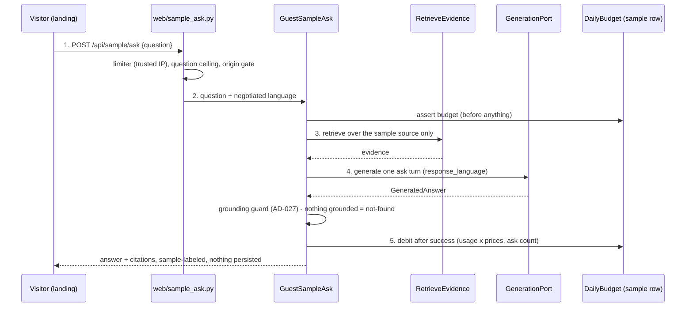
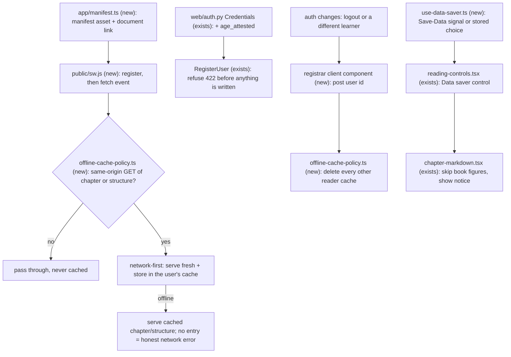
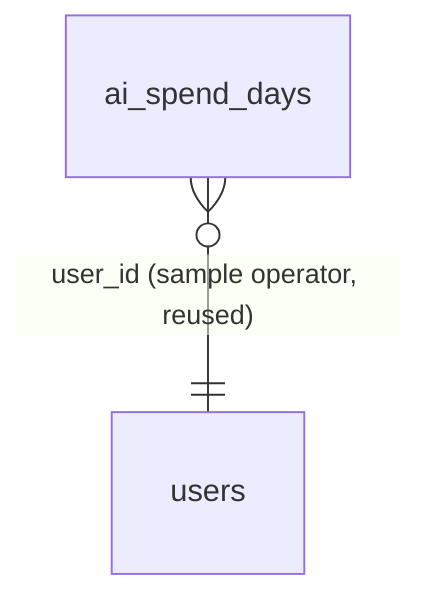

# installable-and-adult-launch

**Approved**: 2026-10-29 - user: "Go autonomously until completing everything"

(The standing authorization that owns the `auto`-mode door-gate waiver for this and every stage of the ship cycle; the two batch gates and the merge gate proceed on it.)

## Problem

Learny is not installable and does not work offline: there is no web app manifest and no service worker (the 2026-09-30 research ledger marks "PWA or offline" Missing). In Brazil, the priority market, 60% of internet users access exclusively by phone and only 22% report satisfactory connectivity (TIC Domicílios 2024), so a mid-range Android phone on a metered connection is the norm — today a learner pays the full payload again on every visit, and a subway ride kills the reading session. The service is also open only to account holders in practice: the shared sample can be read only after registering, the deferred guest taste of Ask (AD-320) never shipped, and signup asserts nothing about age — the adult-only launch posture the research recommends (ANPD minors duty; Gemini's own study notebooks are 18+) has no gate. The legal pages are English-only with a recorded i18n exemption, so a Brazilian learner cannot read what they consent to.

When this ships: a Brazilian learner installs Learny from the browser, reads the chapter they were reading offline, spends less data with images held back, confirms they are 18 on signup, reads the legal pages in Portuguese, and a stranger can taste the cited Ask on the shared sample with no account — strictly capped, honestly refused when the cap is gone.

## Shape

One sentence: the guest ask reuses the exact rails an authenticated Ask runs — `RetrieveEvidence`, the grounding guard, the `GenerationPort` Ask chain, the `DailyBudget` ledger and the `RateLimiter` port — rather than any new spend path. The rules that change an outcome run in the application layer (backend caps, attestation, grounding) and in one frontend cache-policy module the service worker and the tests share; the service worker file itself only wires browser events onto that policy.

1. Visitor question -> `web` proxy (exists) -> `POST /api/sample/ask` in `web/sample_ask.py` (new) - boundary: origin gate, per-IP limiter, question ceiling, no session needed
2. `web/sample_ask.py` -> `GuestSampleAsk` in `application/sample_ask.py` (new) - asserts the sample's daily budget, retrieves over the sample source only, generates one grounded turn, debits after success; persists nothing
3. `GuestSampleAsk` -> `RetrieveEvidence` (exists, guest instance without the activation recorder) + `ground` (exists) + `GenerationPort` Ask chain (exists) + `DailyBudget` (exists, second instance with its own settings) -> out: answer + citations, or the honest refusal
4. Register: `web/auth.py` `Credentials` (exists) gains `age_attested` -> `RegisterUser` (exists) refuses beside the TOS check -> out: 422, nothing written
5. PWA: `app/manifest.ts` (new) + `public/` icons (new) + `public/sw.js` (new, module) + `offline-cache-policy.ts` (new, shared with tests) + a registrar client component (new) posted the signed-in user id -> reader chapter + structure cached per user, foreign caches purged on user change
6. Data saver: `use-data-saver.ts` (new) -> `reading-controls.tsx` (exists) gains the control -> `chapter-markdown.tsx` (exists) skips book figures and the reader shows the notice

**Changes underneath**

| Front | What changes |
| --- | --- |
| domain | none - no domain term changes meaning |
| stored data | nothing to migrate - guest asks write `ai_spend_days` rows for the seeded sample operator (the row already exists; no schema change) |
| readers | the landing page gains the sample ask surface; the register form gains the 18+ confirmation; `/privacy` `/terms` `/copyright` read the catalogs (their i18n exemption is removed); the reader gains the data-saver control and notice |

New: nothing - the only written table exists; no one-way constraint added.

## Surface

| Route | In | Out | Status | Who |
| --- | --- | --- | --- | --- |
| `POST /api/sample/ask` | `{question}` | `{found, answer, citations, sample}` | 200; 422 empty/oversized question; 429 limiter or sample budget exhausted; 503 sample missing, limiter down, AI paused; 502 generation failed | anyone - explicitly signed-out visitors; no session, no CSRF token, Origin gate + limiter instead |
| `POST /api/auth/register` (changed) | + `age_attested` (optional bool, default false) | unchanged | 422 when false or absent, before anything is written | anyone |

The manifest (`/manifest.webmanifest` via `app/manifest.ts`) and `/sw.js` are static assets, not API routes.

## Landing

| One-way door | Literal shape | Alternative rejected |
| --- | --- | --- |
| The guest sample-ask endpoint is a public, unauthenticated write route | `POST /api/sample/ask` `{question}` -> `{found: bool, answer: string|null, citations: [...], sample: true}`; 422/429/503/502 as above; caps enforced backend-side (per-IP limiter + sample budget), never client-side | Reusing `POST /api/conversations/{id}/turns` with an anonymous session - it would mint a persisted conversation identity for someone with no account and put a foreign owner id on a user-owned table |
| The guest spend identity is the seeded sample operator's ledger row | Guest debits land on `ai_spend_days.user_id = <sample operator user>` (`sample-operator@learny.invalid`, created by the sample seed) via a second `DailyBudget` instance with its own `LEARNY_GUEST_SAMPLE_*` settings | A nil/reserved UUID ledger key - the table's FK to `users` would need a migration and a phantom row, and a per-IP ledger would make one NAT cafe exhaust the cap for everyone behind it |

- Recorded as AD-368 (cross-cycle: `biblioteca-aberta` grows the sample family and `paid-hosted-tier` prices the guest surface on the same identity).
- Nothing else in this change is hard to reverse: settings additions, catalog keys, static assets, and a frontend cache module are all additive or deletable; the register body's `age_attested` defaults to refusal, so no stored data depends on it.

## Criteria

### S1: Installable, offline, low-bandwidth (P1)

A Brazilian learner installs Learny on a mid-range Android phone, keeps reading the chapter they were reading with no connection, and stops paying for book figures on a metered connection.

**Acceptance Criteria**

1. WHEN any visitor loads the app THEN the system SHALL serve a web app manifest declaring `name`, `short_name`, `start_url: "/"`, `display: "standalone"`, and icon entries at 192px and 512px (one `any`, one `maskable`), and the document SHALL link it.
2. WHEN the app shell loads in a browser THEN the system SHALL register the service worker at `/sw.js` (module type), and `/sw.js` SHALL exist as a static asset.
3. WHEN a signed-in learner fetches their current chapter or the book's structure THEN the service worker SHALL store the 200 response in that learner's reader cache (network-first: fresh when online).
4. IF the device is offline THEN the service worker SHALL serve the previously cached chapter and structure responses in place of the network, and IF no cached entry exists THEN it SHALL surface the failed network request honestly (no placeholder book text, no fake content).
5. IF a request is not a same-origin GET, or is not the reader's chapter/structure URL pattern, THEN the service worker SHALL pass it through without caching it - this covers every other `/api/` response, every write, and cross-origin requests.
6. WHEN the registrar learns the signed-in user changed (logout, or a different learner signs in on the device) THEN the system SHALL delete every reader cache that does not belong to the current user, so no other learner's cached book data remains; each reader cache SHALL be named for exactly one user id.
7. IF data saver is active (the browser's `Save-Data` signal, or the reader's Data saver control set to on) THEN the reader SHALL NOT request book figures (`/api/sources/.../media/...`) in the chapter and SHALL show its low-bandwidth notice, with the copy in both catalogs.
8. WHEN the learner toggles Data saver in the reading-controls popover THEN the choice SHALL apply immediately and persist device-local across reloads (no server schema), and an explicit Off SHALL override a browser `Save-Data` signal.

### S2: Adults only, legal in Portuguese, a capped guest Ask (P1)

Signup attests adulthood backend-side, the legal pages read in Portuguese, and a stranger gets an honest, capped taste of the cited Ask on the shared sample without an account.

**Acceptance Criteria**

9. IF a register request omits `age_attested` or sends false THEN the backend SHALL refuse with 422 and SHALL NOT create a user, credential, session, or consume an invite - even with a valid email, a valid password, and `accepted_tos: true`.
10. WHEN a register request sends `accepted_tos: true` and `age_attested: true` THEN the backend SHALL create the account exactly as before (the attestation adds one gate and changes nothing else).
11. WHEN the register form renders THEN it SHALL show a required "I am 18 or older" confirmation beside the existing terms checkbox, with copy in both catalogs; submitting without it is stopped by the form, and the backend refusal remains the invariant.
12. WHEN a learner visits `/privacy`, `/terms` or `/copyright` THEN the page SHALL render its full content from the catalogs in the negotiated locale (both catalogs carry every section), the legal-pages exemption in the hard-coded-string sensor SHALL be removed, and the privacy page SHALL include the LGPD data-subject-rights section and an international-transfer note, while the terms SHALL state the 18+ requirement.
13. WHEN a signed-out visitor submits a question about the sample from the landing page THEN the system SHALL return 200 with a grounded answer and citations, clearly labeled as the shared sample, with no user, session, or conversation row created; the answer follows the visitor's negotiated language while citations stay verbatim in the book's language.
14. IF the guest question is empty or exceeds the character ceiling THEN the boundary SHALL refuse 422 before any retrieval, generation, or budget spend.
15. IF the per-IP guest ask cap for the window is exhausted THEN the endpoint SHALL answer 429 with a `Retry-After` hint, keyed on the trusted-proxy client IP + route (a client cannot mint budget with headers).
16. IF the sample's daily budget is spent (USD at the cap, or the daily ask count reached) THEN the endpoint SHALL refuse 429 with the honest exhausted copy before generating - never a silent degradation, never a lower-quality fallback.
17. IF the sample source is missing or the generation produces nothing grounded THEN the endpoint SHALL answer the explicit honest outcome (503 for a missing sample; 200 with `found: false` and no citations for nothing grounded), the same grounding contract as every Ask.
18. WHEN a guest ask succeeds THEN the spend SHALL be asserted before and recorded after on the sample's own daily ledger row (USD by serving profile prices, ask count incremented), and every other write SHALL be absent - no conversations, turns, activation events, or user rows.
19. WHEN the landing page renders for a signed-out visitor THEN it SHALL offer the sample ask - question input prefilled with the sample's suggested question, a visible shared-sample label, the submit gesture showing the cited answer, and catalog copy for the refusals (cap exhausted, offline, failed) in en and pt-BR.

## Out of scope

| Excluded | Why |
| --- | --- |
| Native apps (Play Store / App Store) | The research's must-not-do list: a PWA covers phone-only Android users at a fraction of the cost; revisit after usage data |
| Offline Ask/Tutor/notes/checkpoints offline | Only reading caches offline; generation is a network surface by contract (deterministic adapters exist but product behavior stays online) |
| Push notifications, background sync | Not in the row's scope; no server sender identity exists |
| A guardian/minors flow | The launch posture is 18+; the research defers the minors regime until a guardian flow is designed |
| Localized backend emails | Recorded follow-up candidate from `pt-br-interface`, needs a locale on `EmailPort` - not this row |
| A lawyer's LGPD review (operator prerequisite O3) | This cycle ships the pages and framing; the external legal pass stays an operator item |
| Per-user data-saver preference on the server | Device-local setting honors the browser signal; no schema, no Account surface this cycle |
| Re-capping the authenticated Ask (limiter/spend already shipped in the doors cycle) | The guest surface reuses those rails as-is |

## Assumptions

| Assumption | Chosen default | Rationale | Confirmed? |
| --- | --- | --- | --- |
| What "low-bandwidth budgets" concretely means | Data saver: honor `navigator.connection.saveData` + an explicit reader control; when active, book figures are not fetched and a notice explains it; the service worker never caches media responses and caps the reader cache entries | The research names small payloads and low-end devices, not a specific feature; honoring the platform signal plus an override is the smallest honest budget with a gesture, and the SW cache cap bounds storage on cheap phones | n |
| Where the guest ask lives | The landing page, for signed-out visitors; the route itself answers anyone (a signed-in caller hits the same caps) | The research's goal line is "a no-account taste of the sample"; the authenticated sample experience already exists in the app | n |
| The guest cap values | Question ceiling 400 chars; per-IP 5 asks per 24h window; sample budget $0.50/day and 50 asks/day, each an operator setting | A taste, not a free tier: small enough to be irrelevant as an abuse surface, large enough to convert; every value tunable without a deploy of code | n |
| 18+ attestation storage | Enforce at account creation; record nothing beyond the existing consent stamp (`accepted_tos_at`) | The attestation is part of the same consent act as the terms checkbox; adding a column for it is schema cost with no distinct obligation this cycle - the terms page states the requirement, the backend gate is the invariant | n |
| Service worker shape | A self-contained ES-module `public/sw.js` whose pure helpers are imported by vitest; registration uses `{ type: "module" }` | One source of truth for the cache policy with no new build step; module workers are supported by every engine that installs PWAs today | n |
| Reader cache scope | Chapter + structure GETs only, per-user cache names, network-first, entry cap | Exactly the row's "offline cache of the current book's chapters"; everything else stays network-honest | n |

**Open questions:** none - all resolved above or logged as assumptions; the auto-mode door-gate waiver covers them.

## Differences from the source

None - the sources are research documents that prescribe direction and constraints, not screens; no capture binds this cycle.

## Sources

- `docs/research/2026-09-30/synthesis.md` - binding - the row's scope line, the adult-only recommendation, the must-not-do list (no native apps, no uncapped guest Ask, no analytics SDKs)
- `docs/research/2026-09-30/brazil-market.md` - binding - the device/network/LGPD constraints behind each slice
- `.specs/project/archive/STATE-v1-v7.md` (AD-320, AD-325, AD-330, AD-333) - binding - the thawed deferral's original terms: guest Ask was deferred, not rejected; the limiter/IP rails it must reuse
- `.specs/project/ROADMAP.md` v8 row `installable-and-adult-launch` - binding - the shipped scope
