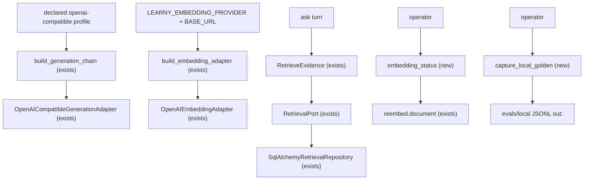
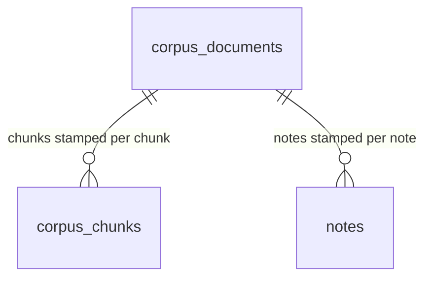

# local-models-self-host — Operator profile for OpenAI-compatible local runtimes

**Approved**: 2026-10-29 - user: "Go autonomously until completing everything"

## Problem

A self-hoster cannot run Learny without cloud keys, and the seams that should let them are undocumented and partly unguarded.

- Generation: the `openai-compatible` profile kind (cheaper-intelligence) can point `base_url` at Ollama or LM Studio, but nothing documents or tests that path. Research 2026-09-30: "Learny's `openai-compatible` profile kind can point at them today. Nothing documents or tests that path."
- Embeddings: ADR-0019 locks retrieval embeddings to OpenAI. A fully offline self-host has no local option, and the research records the row's amendment: "A fully offline self-host also needs local embeddings. That conflicts with ADR-0019's OpenAI lock and needs an amendment, scoped to self-host only and recorded on the existing per-chunk `embedding_model` column."
- Stale vectors: retrieval's semantic arm (`backend/app/infrastructure/db/retrieval.py` `_HYBRID_SQL_TEMPLATE`) filters only `embedding IS NOT NULL` — it never compares the chunk's `embedding_model` stamp to the active adapter identity. An operator who swaps the embedding model (OpenAI ↔ local) gets answers fused from incompatible vector spaces. ADR-0019 already promised "a query never fuses vectors from a different model"; the SQL does not keep that promise. There is also no operator view of which corpus is on which model/dimension, and no tested procedure for changing either.
- Golden results: no pt-BR-capable local model has ever been measured against the golden fixtures, and no runner exists to capture such a result.

Evidence: `docs/research/2026-09-30/synthesis.md` (rq03 move 4, "Local models are cheap to support for self-hosters and unproven for quality"), `docs/research/2026-09-30/byok-and-business-models.md` (operator-level `base_url`), `docs/adr/0019-*`, `docs/adr/0020-*` amendments (profile registry), `backend/app/infrastructure/db/retrieval.py:72`.

When this ships, a self-hoster points Learny at a local OpenAI-compatible runtime for answers and (their choice) embeddings following one documented profile, the suite proves the whole path against a deterministic fake runtime with zero network, swapping the embedding model or dimension makes every affected corpus go stale (lexical-only) until an explicit re-embed, the operator can see and run that re-embed with one command, and an operator with a pt-BR-capable local model can record golden results with a shipped runner.

## Shape

Reuses the profile registry and the compat generation adapter (cheaper-intelligence), the client-injection test seams both adapters already carry, the per-chunk `embedding_model` stamps and the `reembed.document` task (ADR-0019 implementation), the golden-book eval harness, and the `docs/ops/` runbook conventions. The rules that change an outcome run in the composition roots and the retrieval repository — layers the backend suite reaches directly.

1. declared `openai-compatible` generation profile with `base_url` -> `build_generation_chain` (exists) -> `OpenAICompatibleGenerationAdapter` (exists) -> out: a `[^1]`-cited ask answer served from the local runtime
2. `LEARNY_EMBEDDING_PROVIDER=openai-compatible` + `LEARNY_EMBEDDING_BASE_URL` -> `build_embedding_adapter` (exists) -> `OpenAIEmbeddingAdapter` (exists) -> out: an embedding adapter validated per response, stamps `{model}@{dim}`
3. ask turn -> `RetrieveEvidence` (exists) -> `RetrievalPort` (exists) -> `SqlAlchemyRetrievalRepository` (exists) -> out: semantic evidence only where the chunk/note stamp equals the active identity
4. operator -> `embedding_status` (new) -> reads stamps and vector columns -> out: per-source current/stale report, exit `0`/`1`; the printed procedure runs `reembed.document` (exists) to refresh stale chunks
5. operator -> `capture_local_golden` (new) -> golden books (exists) through the real ingestion/retrieval/generation composition -> out: one JSONL line per case under `evals/local/`

New: nothing - no new entity, relation or column; the guard reads and the re-embed rewrites existing `embedding_model` stamp and vector values.

**Changes underneath**

| Front | What changes |
| --- | --- |
| domain | `RetrievalPort.search` gains a required `embedding_model: str` keyword (the active adapter identity); implementers are `SqlAlchemyRetrievalRepository` and `tests/fakes.py::FakeRetrievalPort` |
| domain | new term: *corpus embedding state* — per source, the distinct `corpus_chunks.embedding_model` stamps vs the active identity: `current`, `stale`, or `mixed`; derived, never denormalized |
| existing behavior | retrieval's semantic arm (book and notes) now requires a matching stamp, so a corpus whose vectors came from another model/dimension answers lexical-only until re-embedded — ADR-0019's promised behavior, now actually enforced |
| existing behavior | `OpenAIEmbeddingAdapter` rejects a malformed runtime response (wrong count, non-numeric, wrong dimension) before any write; with `base_url` set, transport failures name the host |
| existing docs | `backend/.env.example` and `backend/.env.production.example` gain the `openai-compatible` embedding wiring; ADR-0019 gains an amendment section; new `docs/ops/local-models.md` |
| stored data | nothing to migrate: no new columns; per-chunk stamps (already on every vector-bearing row used by retrieval) are the source of truth |

## Surface

None - nothing consumed outside the operator's shell and the unchanged web API; this cycle adds two operator commands, recorded here as prose.

- Operator command `uv run python -m app.cli.embedding_status` (settings env in, no args): prints per-source counts (total chunks, current for the active identity, stale, distinct stamps), the active identity and dimension, the vector-column vs active-dimension check, and on misalignment the exact resize + reembed procedure; exit `0` aligned, `1` misaligned. Caller: the self-host operator on the host.
- Operator command `uv run python -m app.cli.capture_local_golden --base-url URL --model ID` (both flags required together): runs the golden cases (English + Portuguese books) through the real composition, records `evals/local/<date>-<sha>-<model>.jsonl`, one JSONL line per case, summary on stdout; exit `0` recorded, `2` usage refusal before any network attempt or DB write. Caller: the self-host operator with a local runtime.

## Landing

| One-way door | Literal shape | Alternative rejected |
| --- | --- | --- |
| 1. Embedding provider contract | `LEARNY_EMBEDDING_PROVIDER` accepts exactly `local`, `openai`, `openai-compatible`; `openai-compatible` requires non-empty `LEARNY_EMBEDDING_BASE_URL` (composition-time `ValueError` naming both variables) and never sends the OpenAI-only `dimensions` request parameter — the runtime's native dimension is validated against `LEARNY_EMBEDDING_DIM` on every response | sending `dimensions` to local runtimes — Ollama/LM Studio ignore or reject OpenAI-only params, so a silent wrong-dimension write is the failure mode this door exists to close |
| 2. Retrieval-port contract | `RetrievalPort.search(..., embedding_model: str)`; the semantic arms filter `embedding_model` equal to it (book arm on `corpus_chunks.embedding_model`, notes arm on `notes.embedding_model`) | a `corpus_documents.embedding_model` column — denormalizes a mixed-in-flight state the per-chunk stamps already record exactly; the research names the existing column as the recording mechanism |
| 3. Embedding-adapter construction | `OpenAIEmbeddingAdapter(api_key=, model=, dimensions=, expected_dim=, base_url="", client=None)`: `dimensions=None` omits the parameter (compat kind), `expected_dim` validates every response; transport failures with `base_url` set re-raise with the host in the message | a separate compat adapter class — the request/response shape is one endpoint (`/v1/embeddings`); only the `dimensions` parameter and the validation differ |
| 4. Golden-capture artifact | `evals/local/` holds local-runtime captures only (never `evals/results/`, which the judge-owned JSONL schema and the dev dashboard own); one JSONL line per case: `case_id, language, question, expected_status, found, cited_chunk_ids, citation_valid, generation_model, base_url, ts, git_sha` | writing into `evals/results/` — the dashboard walks it recursively and would render schema-mismatched lines as corrupt history |
| 5. ADR-0019 amendment (in place, the ADR-0020 pattern) | new `## Amendment (2026-10-29): Self-host local embeddings via OpenAI-compatible runtimes` — self-host only, recorded on the per-chunk stamps, retrieval gate is the forced re-embed guard, dimension changes are an operator procedure (clear + resize + reembed), hosted instances keep the OpenAI lock; Status line updated to "Accepted; amended 2026-10-29 — see Amendment below" | a new superseding ADR — the decision stands (per-chunk versioning, `EmbeddingPort`); only its provider scope widens, and the repo's precedent (ADR-0020 amendments, ADR-0031 approach) records that in place |

- Nothing else is hard to reverse: the CLI entry points are new files, the ops doc is a new file, and the retrieval gate's behavior is the ADR-0019 behavior.

## Criteria

### S1: The local generation profile is documented and tested (P1)

**Acceptance Criteria**

1. WHERE a declared generation profile names kind `openai-compatible` with a `base_url` and a set `api_key_env`, THE system SHALL serve an ask turn through that `base_url` with prompt-cited grounding, proven through the real profile registry → `build_generation_chain` composition against a deterministic fake transport (no network).
2. WHEN the local runtime is unreachable THEN the generation path SHALL raise the Learny taxonomy `ProviderUnavailable` (retryable), never a raw SDK exception, through the same composition.
3. The system SHALL document the operator profile in `docs/ops/local-models.md`: the Ollama (`http://localhost:11434/v1`) and LM Studio (`http://localhost:1234/v1`) endpoints, the placeholder API-key convention for keyless local runtimes, price fields set to `0`, the `prompt-cited` grounding declaration, ask/teach eligibility, and the self-host-only boundary for the local embedding model — asserted by a drift sensor that fails when a required anchor is missing.
4. The operator profile documentation SHALL state the pt-BR evidence position plainly: local models are unproven for cited pt-BR answers until a golden capture records otherwise (no quality claim without results).

**Independent test:** with a declared compat profile pointing at an injected fake client, an ask turn returns a `[^1]`-cited answer and the request carried the profile's `base_url`.

### S2: Local embeddings behind the port, self-host only (P1)

**Acceptance Criteria**

5. WHERE `LEARNY_EMBEDDING_PROVIDER=openai-compatible` and `LEARNY_EMBEDDING_BASE_URL` is set, `build_embedding_adapter` SHALL return an `OpenAIEmbeddingAdapter` whose identity is `{LEARNY_EMBEDDING_MODEL}@{LEARNY_EMBEDDING_DIM}`, built with that base URL.
6. IF `LEARNY_EMBEDDING_PROVIDER=openai-compatible` is set without `LEARNY_EMBEDDING_BASE_URL` THEN composition SHALL raise naming both `LEARNY_EMBEDDING_PROVIDER` and `LEARNY_EMBEDDING_BASE_URL`, before any SDK import or network attempt.
7. WHERE the provider is `openai-compatible`, the adapter SHALL NOT send the `dimensions` request parameter, and every response SHALL be validated: one vector per input, each numeric, each exactly `LEARNY_EMBEDDING_DIM` long.
8. IF a local runtime returns an unexpected shape — a wrong vector count, a non-numeric entry, or a dimension other than `LEARNY_EMBEDDING_DIM` — THEN the adapter SHALL raise before returning, in one message naming the model, the expected dimension, and what was received (count, or the offending dimension).
9. WHEN the local embedding runtime is unreachable THEN the adapter SHALL raise `ProviderUnavailable` whose message names the configured host, so the operator reads which runtime is down.
10. The default SHALL be unchanged: provider `local` builds the deterministic adapter and the offline suite makes no network call (existing suite green with no new network seams).
11. The system SHALL document the local embedding wiring in `backend/.env.example` and `backend/.env.production.example`, stating the self-host-only boundary in the amendment's words.

**Independent test:** `Settings(embedding_provider="openai-compatible")` with no base URL raises `ValueError` naming both variables; with a base URL and an injected fake client returning 768-dim vectors against `embedding_dim=1536`, `embed_documents` raises naming 1536 and 768.

### S3: Changing a corpus's model/dimension forces a re-embed before retrieval answers from stale vectors (P1)

**Acceptance Criteria**

12. WHEN a chunk's `embedding_model` stamp differs from the active adapter identity THEN retrieval SHALL return no semantic evidence from that chunk — the corpus answers lexical-only until re-embedded.
13. WHILE a corpus is mid-re-embed (some chunks stamped current, some stale) THE system SHALL fuse only current-stamped chunks in the semantic arm, never vectors from two identities.
14. WHEN a note's `embedding_model` stamp differs from the active identity THEN the notes semantic arm SHALL apply the same rule against `notes.embedding_model`.
15. IF an embed write would land beside vectors of a different length THEN the system SHALL reject it — every embed write stamps one identity per write, and the column's `vector(N)` typmod refuses a wrong-length insert — asserted at adapter level (criterion 7's validation) and at database level (a wrong-length insert raises).
16. WHEN the embedding dimension changes THEN the operator procedure SHALL be: `embedding_status` reports the column/dimension mismatch and exits `1` printing the exact SQL (drop index, clear vectors, resize `corpus_chunks.embedding`, `notes.embedding`, `quiz_cards.embedding`, recreate index) and the `reembed.document` commands; no automatic resize or silent conversion SHALL exist.
17. WHEN the operator runs `embedding_status` THEN the system SHALL report, per source: total chunks, chunks current for the active identity, stale chunks, and the distinct stamps present (the per-corpus model/dimension tracking), plus the active identity and dimension; exit `0` when the vector columns match the active dimension, exit `1` when not.
18. WHEN the re-embed task for a source completes THEN retrieval SHALL serve semantic evidence from that source again — proven end-to-end offline: embed with identity A, flip the adapter (still offline deterministic at a different dimension), observe lexical-only, run the re-embed body, observe the semantic arm restored with matching stamps.

**Independent test:** against the test DB, embed a source with the deterministic adapter, hand-stamp one chunk with a foreign identity, and search: the semantic arm skips that chunk while the lexical arm still finds it.

### S4: Golden results for a pt-BR-capable local model (P2)

**Acceptance Criteria**

19. WHEN the operator runs `capture_local_golden --base-url URL --model ID` THEN the system SHALL run every golden case (English golden book + the Portuguese golden book cases) through the real ingestion, embedding, retrieval and generation composition, with generation answered by an `openai-compatible` adapter at `--base-url` naming `--model`, and SHALL record one JSONL line per case under `evals/local/` with the door-4 fields.
20. IF `capture_local_golden` is invoked without `--base-url` or `--model` THEN it SHALL exit `2` with a usage error before any network attempt or DB write.
21. The capture runner SHALL be proven offline end-to-end against an in-process OpenAI-compatible fake server (loopback, ephemeral port, deterministic scripted responses) — the same runner an operator points at Ollama, no test-only branches.
22. WHEN no local runtime exists on this machine THEN the pt-BR golden capture SHALL be recorded as operator-gated with the reason stated plainly in this feature's records and the STATE handoff (no local runtime installed; the no-install policy for the owner's machine; a multi-GB model download) — never faked; the ops doc SHALL carry the exact capture procedure for the operator to run.

**Independent test:** run the capture against the in-process fake; `evals/local/` gains one line per golden case and every line's `generation_model` is the `--model` argument.

## Out of scope

| Excluded | Why |
| --- | --- |
| Judged faithfulness/quality scores for local-model captures | the judge is an Anthropic structured-output call; judging a local model's pt-BR quality is a study, not a capture — the runner records deterministic facts plus the raw answer |
| HTTP/API surfaces for embedding status or re-embed triggering | the operator is on the host; a CLI is the honest smallest surface and the worker owns re-embed execution |
| Automatic dimension resize or silent vector conversion | a one-way data operation on a shared corpus; the operator runs the explicit procedure the CLI prints |
| Relaxing profile-registry validation for keyless localhost hosts | touches the learner-key binding rules the byok lane is reworking; the placeholder `api_key_env` convention avoids it |
| Any quality claim about pt-BR answers from local models | no recorded results exist yet; claims follow captures, not hope |

## Assumptions

| Assumption | Chosen default | Rationale | Confirmed? |
| --- | --- | --- | --- |
| Generation side needs no code change | this cycle adds the documented profile, the composition test, and the doc sensor only | cheaper-intelligence shipped the adapter; the research says "the work is in … documentation and testing, not in the request path" | n |
| Keyless local runtime keeps `api_key_env` in the declared profile (placeholder value like `ollama`) | no registry-validation relaxation for localhost hosts | relaxing it touches the learner-key binding rules the byok lane is reworking; Ollama's own docs use the placeholder convention | n |
| Local embedding API key is `LEARNY_OPENAI_API_KEY` when set, else a fixed non-empty placeholder | no new secret setting; local runtimes ignore the key; the OpenAI SDK requires a non-empty string | no behavior change for the `openai` provider | n |
| Golden-capture quality scores out of scope | the capture records deterministic facts (found/cited/valid) plus the raw answer | the judge is Anthropic structured-output machinery (ADR-0028); judged faithfulness on a local model is a study, not a capture | n |
| A real Ollama run is operator-gated, not attempted here | `ollama` is not installed on this machine, the owner's no-install policy applies, and a pt-BR-capable model is a multi-GB download | mission constraint + portfolio-truthful precedent (operator-gated items recorded with reasons, never faked) | n |
| Known-red locally, not this lane's | `tests/test_image_pins.py::test_the_scan_reaches_every_kind_of_image_reference` fails on Windows path separators; the harness lane ships the fix | coordinator addendum 2026-10-29 | n |

**Open questions:** none - all resolved or logged above.

## Sources

- `docs/research/2026-09-30/synthesis.md` rq03 move 4 — the roadmap row's evidence: compat profiles reach local runtimes today, untested; local embeddings need the ADR amendment; quality unproven
- `docs/research/2026-09-30/byok-and-business-models.md` — operator-level `base_url` and the self-host economic position
- `docs/adr/0019-retrieval-embeddings.md` — the ADR this cycle amends (self-host widening, per-chunk stamps)
- `docs/adr/0020-*.md` (amendments) — the in-place amendment pattern door 5 follows
- `.specs/project/ROADMAP.md` row `local-models-self-host` — the mission this plan decomposes
