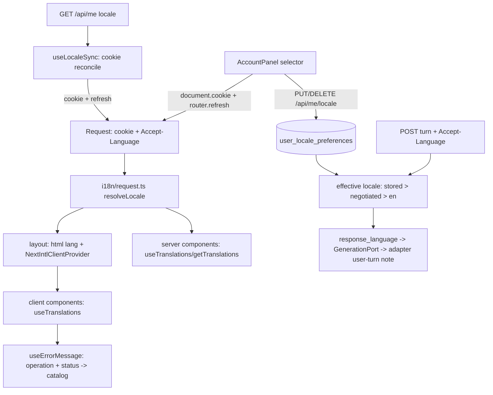

# pt-br-interface Design

**Spec**: `.specs/features/pt-br-interface/spec.md`
**Status**: Approved (auto-decided per ship-cycle; decisions in `context.md`, ADR-0032)

---

## Architecture Overview

Locale is decided per request on the server from the `learny_locale` cookie, then `Accept-Language`, then `en`. That decision feeds `getRequestConfig` (next-intl) so server components translate with no client provider; the root layout also hands the active catalog to `NextIntlClientProvider` for the 59 client components. The cookie is a render-time cache: the backend stores the learner's choice (`user_locale_preferences`), and the logged-in client reconciles the cookie from `GET /api/me` `locale`. The same effective-locale rule runs on the backend for Ask/tutor turns and yields an optional `response_language` that the generation adapters turn into a user-turn instruction.



---

## Code Reuse Analysis

### Existing Components to Leverage

| Component | Location | How to Use |
|---|---|---|
| House-profile preference slice | `backend/app/infrastructure/web/ai.py`, `db/repositories.py:162`, `domain/ports.py:149`, migration `0029_user_ai_preferences.py` | Template for the locale preference: entity, port, repo (`pg_insert` ON CONFLICT), `enforce_csrf` PUT, idempotent DELETE |
| `/me` session payload | `backend/app/infrastructure/web/auth.py` (`MeResponse`, `GET /me`) | Add `locale: str \| None`, injected like `get_ai_profile_choice` |
| `AccountPanel` + `ai-profiles.ts` | `frontend/app/components/AccountPanel.tsx`, `app/lib/ai-profiles.ts` | Pattern for the selector: confirm-then-move UI, csrf from `fetchAuthState()` |
| `fetchAuthState` | `frontend/app/lib/auth.ts` | Carries `user.locale`; drives `useLocaleSync` |
| Same-origin proxy | `frontend/app/api/[...path]/route.ts`, `app/lib/proxy.ts` | Forwards `Accept-Language`, cookies and bodies unchanged — no change |
| Generation seams | `domain/ports.py:694` `GenerationPort`, `application/conversations.py` `PostConversationTurn`, `answering/{anthropic,openai_compat,local,routing}.py`, `tests/fakes.py` | Thread one optional `response_language` kwarg |
| Frozen prompts | `answering/prompts.py` | Untouched; new per-language note constants beside them |
| Golden harness | `tests/golden_corpus.py`, `golden_expected.py`, `epub_builder.py` | Pattern for the Portuguese book |
| Language detection / FTS | `application/language.py`, `search_config` | Unchanged; the fixture proves them |

### Integration Points

| System | Integration Method |
|---|---|
| next-intl plugin | `next.config.ts` wrapped with `createNextIntlPlugin()` (keeps `output: "standalone"`; prod-image tests re-checked) |
| Typed messages | `frontend/global.d.ts`: `declare module "next-intl" { interface AppConfig { Locale: "en" \| "pt-BR"; Messages: typeof en } }` |
| Vitest | `setupFiles: tests/setup-intl.ts` binds next-intl to `use-intl` `createTranslator`/`createFormatter` over `en`; `setTestLocale()` switches |
| Docs drift | README ADR count 31 → 32 (`test_readme_truth`) |

---

## Components

### Locale core (`frontend/i18n/config.ts`)
- **Purpose**: the one place that knows the locales and decides one.
- **Interfaces**: `LOCALES = ["en","pt-BR"] as const`; `type AppLocale`; `DEFAULT_LOCALE = "en"`; `LOCALE_COOKIE = "learny_locale"`; `isLocale(v): v is AppLocale`; `negotiateLocale(acceptLanguage: string \| null): AppLocale` (first tag whose primary subtag is `pt` before any `en` → `pt-BR`; q-values honored; malformed → `en`); `resolveLocale({cookie, acceptLanguage}): AppLocale`.
- **Dependencies**: none (pure, importable from client and tests).

### Request config (`frontend/i18n/request.ts`)
- `getRequestConfig` reads `cookies()` + `headers()`, calls `resolveLocale`, imports `messages/${locale}.json`. Lives next to a `next.config.ts` plugin call.

### Catalogs (`frontend/messages/{en,pt-BR}.json`)
- Namespaced by surface: `common`, `errors` (`status.*`, `operation.*`), `landing`, `auth`, `shell`, `home`, `library`, `reader`, `chat`, `review`, `notes`, `account`, `meta`. ICU plurals via `{count, plural, one {…} other {…}}`. `en` is the typing source of truth.

### Root layout (`frontend/app/layout.tsx`)
- Async server component: `getLocale()`, `getMessages()`, `<html lang={locale}>`, `NextIntlClientProvider`, `generateMetadata` from `meta.*`. Legal pages wrap their content in `<div lang="en">`.

### Error plumbing (`frontend/app/lib/errors.ts`, `app/components/use-error-message.ts`)
- **Interfaces**: `class ApiError extends Error { operation: OperationKey; status: number; detail?: string }`; `toApiError(res, operation)`; hook `useErrorMessage(): (err: unknown, operation?: OperationKey) => string` resolving 401/429/5xx status copy first, else `errors.operation.<op>`, else `errors.generic`. Existing typed errors (`StreamRequestError`, `AiProfileRequestError`, `ConversationRequestError`, `NoteError`) extend or wrap it so existing `instanceof`/`status` consumers keep working.

### Locale client (`frontend/app/lib/locale.ts`, `LocaleSwitcher`, `useLocaleSync`)
- **Interfaces**: `writeLocaleCookie(locale)`; `putLocaleChoice(locale, csrf)`, `deleteLocaleChoice(csrf)`; `<LocaleSwitcher mode="anonymous" />` (cookie only); Account section "Language" with Automatic / English / Português (Brasil); `useLocaleSync(authState)` reconciles cookie ← `user.locale` once per load then `router.refresh()`.

### Sensors (`frontend/tests/i18n-parity.test.ts`, `i18n-hardcoded.test.ts`)
- Per `context.md` D-7/D-8; the ratchet list lives in the test file.

### Backend locale (`backend/app/domain/locale.py`)
- **Interfaces**: `SUPPORTED_LOCALES = ("en","pt-BR")`; `negotiate_locale(accept_language: str \| None) -> str`; `effective_locale(stored: str \| None, accept_language: str \| None) -> str`; `response_language_for(locale: str) -> str \| None` (`None` for `en`). Pure; mirrors the frontend rule and is tested against the same vectors.

### Backend preference slice
- Entity `LocalePreference(user_id, locale, created_at, updated_at)`; port `LocalePreferenceRepository.get_by_user/upsert/delete`; table `user_locale_preferences`; migration `0030_user_locale_preferences`; `SqlAlchemyLocalePreferenceRepository`; router `web/locale.py` `PUT /api/me/locale` (`enforce_csrf`, 422 outside the set) and `DELETE /api/me/locale` (204 idempotent); `MeResponse.locale`.

### Response language (backend)
- `GenerationPort.generate/generate_stream(..., response_language: str | None = None)`; `PostConversationTurn.__call__/stream(..., response_language=None)` threads it into `_generate`/`_generate_stream`; the conversations router computes it from the stored preference + `Accept-Language` header. `answering/prompts.py` gains `RESPONSE_LANGUAGE_NOTES: dict[str,str]` and `response_language_note(lang)`; Anthropic appends it to the user turn (teach envelope / Ask question turn), compat appends it to the user message, local ignores, `RoutingGenerationAdapter` forwards. Fakes in `tests/fakes.py` record it.

### Portuguese golden (`backend/tests/golden_pt_corpus.py`)
- `golden_pt_book()` built with `epub_builder`, `dc:language` `pt`, three chapters from one public-domain Machado de Assis work, provenance in the docstring; entries in `golden_expected.GOLDEN_FIXTURES`, `RETRIEVAL_CASES`, `CITATION_CASES`.

---

## Data Models

```python
@dataclass(frozen=True)
class LocalePreference:
    user_id: UUID
    locale: str            # one of SUPPORTED_LOCALES
    created_at: datetime
    updated_at: datetime
```

`user_locale_preferences(user_id uuid PK FK users.id ON DELETE CASCADE, locale text NOT NULL, created_at timestamptz, updated_at timestamptz)`. A CHECK constraint is not added: the supported set lives in code so a third locale is not a migration; reads treat an unknown stored value as unset.

```typescript
type AppLocale = "en" | "pt-BR";
type MeLocale = AppLocale | null;   // AuthState.user.locale
```

---

## Error Handling Strategy

| Error Scenario | Handling | User Impact |
|---|---|---|
| Cookie holds an unsupported value | `resolveLocale` ignores it, negotiates | Renders by `Accept-Language` or `en` |
| Stored locale no longer supported | Backend returns `null` for it | Treated as automatic |
| `PUT /api/me/locale` fails (network/5xx/401/403) | Cookie not written, UI keeps old locale | Localized error in Account |
| Catalog key missing at runtime (should be impossible: tsc + parity) | next-intl `onError`/`getMessageFallback` returns the key path | Visible key, never a crash; sensors fail CI first |
| `/api/me` unreachable during sync | Sync skipped | Cookie/negotiated locale remains |
| Operation fails | `useErrorMessage` maps status then operation | Localized sentence; backend `detail` never shown |
| Adapter lacks response-language support | kwarg ignored | Answer exactly as today |

---

## Risks & Concerns

| Concern | Location (file:line) | Impact | Mitigation |
|---|---|---|---|
| Lib clients embed English fallback copy and render backend `detail` | `frontend/app/lib/quiz.ts:385-395`, `reading.ts:176`, `notes.ts:282`, `study.ts:119`, `auth.ts:139`, `sections.ts:53`, `ingestion.ts:37`, `ai-profiles.ts:146`, `conversations.ts:235` | English leaks into pt-BR; sensor-blind | Single `ApiError`/`useErrorMessage` plumbing (phase 3) before surface migrations; sensor rule on `new Error("…")` in `app/lib` |
| Root layout reads `cookies()`/`headers()`, making every page dynamic | `frontend/app/layout.tsx` | Loses static prerender of landing/legal pages | Pages are already per-request (auth-driven, `force-dynamic` proxy); landing is a thin server page — accepted and noted in the ADR; verified by `next build` in CI |
| Vendored shadcn/ai-elements primitives carry English sr-only/default text | `frontend/components/ui/*`, `components/ai-elements/*` | English leaks in dialogs/sidebar | Migrate the strings that render by default via props with catalog-backed defaults at the call sites; sensor scans them (not allowlisted) |
| Prefix-less locale and proxy catch-all | `app/api/[...path]/route.ts` | A `/api/locale` route would be shadowed | No route handler: cookie written client-side (D-4) |
| `ANSWER_SYSTEM_PROMPT`/`TEACHING_SYSTEM_PROMPT` byte-stable by test | `answering/prompts.py:1-48`, frozen-prompt tests | A system-prompt edit breaks cache + tests | Instruction only in user turn; `en` adds nothing; test asserts system block identical with and without the language |
| Tests assert English strings in ~77 files | `frontend/tests/*` | Churn / false greens | Setup-file binding keeps `en` assertions; a pt-BR render test per surface family; layout test uses the real provider |
| Hidden hard-coded strings in JS expressions | sensor limits | Residual English | Documented limits; manual pt-BR walk in the PR; typed keys + parity catch the rest |
| Accept-Language trust on the backend | `web/conversations.py` | Header is client-controlled | Only ever selects between two fixed instruction strings; no interpolation of header content |

---

## Tech Decisions (only non-obvious ones)

| Decision | Choice | Rationale |
|---|---|---|
| `Accept-Language` negotiation | Own 20-line `negotiateLocale` (q-values, `pt*`→`pt-BR`) in both languages | next-intl no-routing mode has none; `@formatjs/intl-localematcher` is overkill for two locales |
| Dev-only `dev/evals` page | Allowlisted in the sensor, left English | Operator surface, not learner-facing; reason recorded |
| `en` response instruction | None | Preserves frozen prompts/snapshots (AD-371) |
| Anonymous language switch | Cookie only, no API | No session; account choice overrides on login (backend wins) |

> Project-level decisions are in `STATE.md` as AD-363..AD-373 and ADR-0032.
