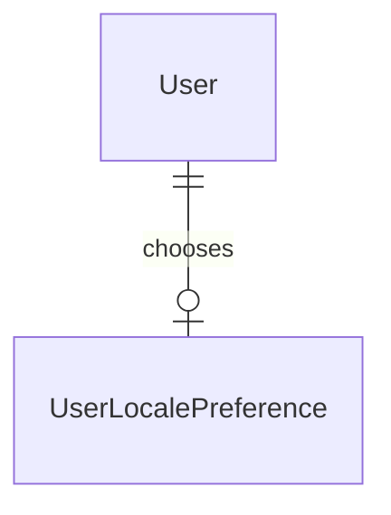

# pt-br-interface

## Problem

A Portuguese-speaking stranger cannot use Learny. `frontend/app/layout.tsx:33` hard-codes `lang="en"`, there is no i18n dependency, and every learner-facing string is an inline English literal across ~83 `.tsx` files and the `app/lib` request clients. Brazil is the priority market and 60% of Brazilian internet users are phone-only; Gemini Notebook is fully localized in pt-BR, so an English-only interface loses before the loop is ever seen. Content-side Portuguese already works (language detection, `portuguese` FTS regconfig, OCR `en,pt`, Portuguese quiz stopwords), so a Brazilian learner can ingest and search a Portuguese book but cannot read the product around it, and the tutor answers in whatever language the model picks.

When this ships, a learner whose browser prefers Portuguese sees Learny in pt-BR from the first request, can pin the language in Account so it follows them across devices, and gets Ask and tutor answers in Portuguese from an English book with the citations still verbatim in the book's language.

## Flow

Reuses the same-origin proxy (forwards cookies and `Accept-Language` untouched), the `fetchAuthState`/`AccountPanel` confirm-then-move pattern, and the house-profile preference slice as the template for the stored choice.

Render path
1. browser request (cookie `learny_locale`, `Accept-Language`) -> `i18n/request.ts` (new, door 1, 3) - cookie, else `Accept-Language`, else `en`
2. `app/layout.tsx` (exists) - sets `<html lang>`, hands the active catalog (door 2) to `NextIntlClientProvider`
3. server and client components (exist) - read copy by typed key; `useErrorMessage` (new, door 6) turns an `ApiError` into catalog text

Choice path
4. `AccountPanel` (exists) -> `PUT /api/me/locale` through the proxy (exists) -> `web/locale.py` (new, door 5) -> `LocalePreferenceRepository` (new, door 4); on success the client writes the cookie and calls `router.refresh()`
5. `GET /api/auth/me` (exists) returns `locale`; `useLocaleSync` (new, no door - placement per conventions) rewrites the cookie from it when they differ and refreshes once

Answer path
6. `POST` conversation turn -> `web/conversations.py` (exists) - stored locale, else `Accept-Language`, via `domain/locale.py` (new, door 4, 7)
7. `PostConversationTurn` (exists) -> `GenerationPort` (exists, door 7) -> Anthropic / OpenAI-compatible adapter (exist) - fixed per-language note appended to the user turn; deterministic adapter ignores it

## Impact

| Front | What changes |
| --- | --- |
| domain | new term: `locale` - one of `en`, `pt-BR`; the interface language, lives in `domain/locale.py` and `i18n/config.ts` |
| domain | new term: `response language` - the language an answer is requested in, `None` for `en`, lives in `domain/locale.py` |
| domain | existing term: `Error.message` from the request clients meant English text shown to the learner, now means an operation key - `account`, `library`, `review`, `reader`, `notes`, `ask`/`teach` panels and `use-*` hooks render it today |
| existing UI | ~83 `.tsx` files carry inline English; `<html lang="en">` hard-coded; the root layout starts reading `cookies()`/`headers()`, so landing and legal pages render per request instead of statically |
| existing tests | ~77 frontend tests assert English strings; they keep passing for `en` through a setup-file binding, not a provider wrapper |
| existing backend | `GenerationPort.generate`/`generate_stream` gain an optional kwarg; implementers are `DeterministicGenerationAdapter`, Anthropic, OpenAI-compatible, `RoutingGenerationAdapter` and `tests/fakes.py` |
| existing docs | README ADR count 31 -> 32 (`test_readme_truth`); CLAUDE.md status paragraph |
| stored data | nothing to migrate: a new table, no row means automatic |

## Relations

One-way constraints: one preference row per user, deleted with the user (door 4). No columns and no types here.

## Surface

| Route | In | Out | Status |
| --- | --- | --- | --- |
| `PUT /api/me/locale` | `locale` | `locale` | `200`, `401`, `403`, `422` |
| `DELETE /api/me/locale` | none | empty | `204`, `401`, `403` |
| `GET /api/auth/me` (adds a field) | session cookie | existing user payload plus `locale` (`en` · `pt-BR` · `null`) | `200`, `401` |

## Landing

| One-way door | Literal shape | Alternative rejected |
| --- | --- | --- |
| 1. i18n library | `"next-intl": "^4.14.9"`, `createNextIntlPlugin()` in `next.config.ts`, `i18n/request.ts` via `getRequestConfig` - no middleware, no URL prefix | `/[locale]` routing - moves every route and redirect and the `/api/[...path]` proxy catch-all would sit under it; `react-i18next` - client-first, server copy would need a provider; hand-rolled - reimplements ICU plurals and typed keys |
| 2. Catalog format | `frontend/messages/{en,pt-BR}.json`, ICU MessageFormat, namespaced by surface (`common`, `errors`, `landing`, `auth`, `shell`, `home`, `library`, `reader`, `chat`, `review`, `notes`, `account`, `meta`), key types from `en` through `AppConfig.Messages` | TS-module catalogs - cannot be diffed or parity-checked without executing code; catalogs colocated per component - no single file for a translator and no key-set to compare |
| 3. Locale cookie | `learny_locale=en\|pt-BR; Path=/; Max-Age=31536000; SameSite=Lax`, written by the client after the PUT succeeds | a backend-set HttpOnly cookie - the proxy forwards `Set-Cookie` unchanged by design and the layout would need a backend call per render; `NEXT_LOCALE` - next-intl's routing name, we have no routing |
| 4. Preference storage and the supported set | table `user_locale_preferences`: `user_id` uuid PK, FK `users.id` ON DELETE CASCADE, `locale` text NOT NULL, no CHECK; supported set `en`, `pt-BR` lives in code on both sides, unknown stored value reads as unset | a column on `user_ai_preferences` - that row means "chose a profile" and is deleted when the profile resets; a column on `users` - widens identity, verification and sample-owner paths; a CHECK constraint - a third locale would need a migration |
| 5. API contract | `PUT`/`DELETE /api/me/locale`, `locale` on `GET /api/auth/me`, values exactly `en` or `pt-BR` | a second `GET /api/me/locale` - nothing would consume it |
| 6. Request-error model | `ApiError {operation, status, detail}`; the learner sees `errors.operation.<op>` or `errors.status.<class>`, never `detail` | backend error codes - a cross-cutting API contract change for no learner-visible gain; keep showing `detail` - leaks English into pt-BR whenever the backend explains the failure |
| 7. Response-language port kwarg | `response_language: str \| None = None` on `GenerationPort.generate`/`generate_stream`; the instruction is a fixed per-language constant appended to the user turn; `en` sends nothing | per-language system prompts - doubles the cacheable frozen prefixes; a post-hoc translation call - a second provider call that can alter citations |

- Nothing else in this change is hard to reverse

## Criteria

### S1: The interface renders in the visitor's language (P1)

A visitor's cookie or browser language picks `en` or `pt-BR`, `<html lang>` follows, and copy comes from typed catalogs.

**Acceptance Criteria**

1. The system SHALL support exactly the locales `en` and `pt-BR`, with `en` as the fallback.
2. WHEN a request carries a `learny_locale` cookie with a supported value THEN the system SHALL render that locale regardless of `Accept-Language`.
3. WHEN no valid `learny_locale` cookie is present and `Accept-Language`, ordered by q-value then position, reaches a `pt` or `pt-*` tag before any `en` tag THEN the system SHALL render `pt-BR`.
4. IF the `learny_locale` cookie holds a value outside `{en, pt-BR}` THEN the system SHALL ignore it and negotiate from `Accept-Language`.
5. IF `Accept-Language` is absent, malformed or lists no supported language THEN the system SHALL render `en`.
6. The system SHALL set `<html lang>` to the rendered locale, `en` or `pt-BR`.
7. IF a message key used in code is missing from the `en` catalog THEN `tsc --noEmit` SHALL fail.
8. WHERE a third catalog file and one entry in the supported-locale list are added THE system SHALL render that locale with no change to routing or components.

**Independent test:** request `/` with `Accept-Language: pt-BR,pt;q=0.9,en;q=0.8` and no cookie and see `<html lang="pt-BR">`; add `learny_locale=en` and see English.

### S2: A learner chooses a language and keeps it (P1)

Account stores the choice per learner; the cookie is the render-time cache; anonymous visitors can switch with the cookie alone.

**Acceptance Criteria**

9. WHEN an authenticated learner picks a locale in Account THEN the system SHALL send `PUT /api/me/locale`, and only after a `200` write the cookie and re-render in that locale.
10. WHEN an authenticated learner picks "Automatic" in Account THEN the system SHALL send `DELETE /api/me/locale`, clear the cookie and fall back to negotiation.
11. IF the save fails THEN the system SHALL keep the previous locale and show a localized error in Account.
12. WHEN `PUT /api/me/locale` receives `locale` outside `{en, pt-BR}` THEN the system SHALL respond `422` and store nothing.
13. IF `PUT` or `DELETE /api/me/locale` has no session THEN the system SHALL respond `401`, and with a session but no valid CSRF token `403`, storing nothing.
14. WHEN `DELETE /api/me/locale` is repeated with no stored row THEN the system SHALL respond `204`.
15. The system SHALL return the stored locale, or `null` when none is stored or the stored value is unsupported, as `locale` on `GET /api/auth/me`.
16. IF a learner calls the locale API THEN the system SHALL read and change only that learner's own preference.
17. WHEN a user row is deleted THEN the system SHALL delete that user's stored locale.
18. WHEN an authenticated page loads and `GET /api/auth/me` returns a `locale` different from the `learny_locale` cookie THEN the system SHALL rewrite the cookie to the stored value and refresh once; WHEN it returns `null` or the same value THEN the system SHALL NOT refresh.
19. WHEN an anonymous visitor picks a language on the landing or sign-in switcher THEN the system SHALL set the `learny_locale` cookie (`Path=/`, `Max-Age=31536000`, `SameSite=Lax`) and re-render without any API call.
20. WHEN the locale changes THEN the system SHALL re-render through `router.refresh()` and SHALL NOT reload the page, so client state (unsent Chat input, reader position) survives.

**Independent test:** pick Português (Brasil) in Account, clear cookies, sign in again, and the interface renders in pt-BR.

### S3: Failures speak the learner's language (P1)

Request clients throw typed errors; the catalog supplies the sentence.

**Acceptance Criteria**

21. WHEN a request client receives a non-OK response THEN the system SHALL throw an `ApiError` carrying the operation key, the HTTP status and the backend `detail` as data.
22. WHEN an operation fails with `401`, `429` or a `5xx` status THEN the system SHALL show the shared localized message for that status class instead of the operation's generic failure copy.
23. WHEN an operation fails with any other status THEN the system SHALL show the operation's localized failure copy.
24. The system SHALL NOT display a backend-sent `detail` string to the learner.
25. The existing `StreamRequestError`, `NoteError` kinds and `AiProfileRequestError` status behavior SHALL continue to satisfy their current consumers.

**Independent test:** in `pt-BR`, make `GET /api/sources` fail with `500` and an English `detail`; the library shows the Portuguese server-error message.

### S4: Landing, sign-in and the shell in Portuguese (P1)

**Acceptance Criteria**

26. WHILE the locale is `pt-BR` the system SHALL render landing, login, register, password reset, email verification, the app shell (sidebar, header, theme toggle, keyboard-shortcut help, not-found notice) and the default text of vendored dialog/sheet/sidebar primitives from the pt-BR catalog.
27. WHILE the locale is `en` the system SHALL render the same English copy these surfaces show today.
28. The system SHALL keep `/terms`, `/privacy` and `/copyright` in English in every locale with `lang="en"` on their content wrapper.

**Independent test:** with `learny_locale=pt-BR`, open `/`, `/login`, `/register` and see no English UI copy outside the legal pages.

### S5: Home and Library in Portuguese (P1)

**Acceptance Criteria**

29. WHILE the locale is `pt-BR` the system SHALL render Home, Library, ingestion status and every empty, loading and error state of both from the catalog.
30. WHILE the locale is `pt-BR` the system SHALL format dates, times and counts with that locale's rules, so a count of 1 renders "1 livro" and 2 renders "2 livros".
31. The system SHALL show book titles, author names and section titles unchanged in every locale.

### S6: The reader in Portuguese (P1)

**Acceptance Criteria**

32. WHILE the locale is `pt-BR` the system SHALL render reader chrome, table of contents, reading controls, margin rail, progress text, aria labels and keyboard help from the catalog.
33. The system SHALL render chapter text and citation snippets unchanged in every locale.

### S7: Chat dock in Portuguese (P1)

**Acceptance Criteria**

34. WHILE the locale is `pt-BR` the system SHALL render the Ask and Tutor panels, answer phases, the not-found answer, failed turns, the conversation list, the include-notes toggle, save-to-note and the dock Notes and Review tabs from the catalog.
35. The system SHALL never render or translate the machine sentinel `NOT_FOUND_IN_SOURCE`.

### S8: Review in Portuguese (P1)

**Acceptance Criteria**

36. WHILE the locale is `pt-BR` the system SHALL render review sessions, rating buttons, FSRS interval labels, the empty-deck and done-for-today states, quiz generation progress and the study heatmap (month and weekday names, legend) from the catalog and the locale's date rules.

### S9: Notes in Portuguese (P1)

**Acceptance Criteria**

37. WHILE the locale is `pt-BR` the system SHALL render the notes list, note detail, capture popover, card suggestions and anchor badges from the catalog.
38. The system SHALL show user-authored note titles and bodies unchanged in every locale.

### S10: English strings cannot creep back (P1)

**Acceptance Criteria**

39. IF a message key exists in one catalog and not the other THEN the parity test SHALL fail naming the key and the missing locale.
40. IF a message uses different ICU argument names in the two catalogs THEN the parity test SHALL fail naming the key.
41. IF a translated `.tsx` file contains a JSX text node of two or more ASCII letters, or a string literal in `aria-label`, `title`, `placeholder` or `alt`, outside the documented allowlist THEN the hard-coded-string test SHALL fail naming file and line.
42. IF an `app/lib` file passes a copy-bearing string literal (letters and whitespace - a sentence, not an operation key) to `new Error(`, `new ApiError(` or any other `new …Error(` THEN the hard-coded-string test SHALL fail naming file and line.
43. IF a file listed as pending migration is already clean THEN the hard-coded-string test SHALL fail naming the file.
44. The system SHALL document the hard-coded-string heuristic's limits in the test header and in the ADR.

**Independent test:** delete one key from `pt-BR.json` and add `
Hello there
` to a translated component; `make test-frontend` fails on each.

### S11: Ask and tutor answer in the learner's language (P2)

**Acceptance Criteria**

45. WHEN an Ask or tutor turn is posted and the effective locale is `pt-BR` THEN the system SHALL pass `pt-BR` to the generation port as the response language.
46. WHEN the effective locale is `en` THEN the system SHALL pass no response language and build requests identical to today's.
47. The system SHALL derive the effective locale from the stored locale when supported, else from `Accept-Language`, else `en`.
48. WHEN the Anthropic adapter builds a request with a response language THEN the system SHALL put the instruction in the user turn and leave the system block and cache breakpoint placement unchanged.
49. WHEN the OpenAI-compatible adapter builds a request with a response language THEN the system SHALL put the instruction in the user message and leave its system prompt unchanged.
50. The system SHALL keep the whole-reply sentinel `NOT_FOUND_IN_SOURCE` mapping to `found=False` and keep citation snippets verbatim from the evidence.
51. The deterministic adapter SHALL return identical output for every response-language value.
52. IF `Accept-Language` carries arbitrary text THEN the system SHALL use only the fixed per-language constants and never place header content in a prompt.

**Independent test:** a recording fake adapter sees `pt-BR` for a pt-BR learner and nothing for an `en` learner; the Anthropic request shows the instruction in the user turn only.

### S12: A Portuguese public-domain golden book (P2)

**Acceptance Criteria**

53. The system SHALL include a Portuguese golden book (OPF `dc:language` `pt`) built in code from short excerpts of one public-domain Portuguese work, with its provenance in the fixture module.
54. WHEN the Portuguese golden book is ingested THEN the system SHALL store its chunks with `search_config` `portuguese` and the expected section and anchor structure.
55. WHEN a golden question uses an inflected form of a term in the target section THEN retrieval SHALL return that section's anchor within the top 3 results.
56. WHEN the deterministic adapter answers a Portuguese golden question THEN every cited chunk id SHALL belong to the retrieved evidence and cite the expected anchor.
57. The system SHALL run the Portuguese fixture offline with the deterministic adapters and no provider key.

**Independent test:** `make test-backend` runs the Portuguese golden retrieval and citation checks with `make infra` up and no network.

## Out of scope

| Excluded | Why |
| --- | --- |
| Machine translation of book text, citations, notes or user content | Citations stay verbatim; user content is the user's |
| Retrieval, FTS language handling, chunking, embeddings | Already correct for Portuguese; no change |
| A pt-BR-specific model or provider; new provider SDKs | ADR-0019/0020 lock |
| Locales beyond `en` and `pt-BR` | A third locale must be catalog-only; none ships |
| URL-prefixed locale routing | Cookie plus `Accept-Language` keeps routes and the proxy untouched |
| Translating `/terms`, `/privacy`, `/copyright` | Needs the LGPD legal pass (operator prerequisite); English with `lang="en"` this cycle |
| Localizing backend-sent emails (verify, reset) | Needs a locale argument on `EmailPort` and the register/reset flows; recorded as a follow-up row |
| Localizing quiz and card generation prompts and the eval judge prompts | Cards follow the book's language; only Ask and tutor answers speak the UI language |
| Operator-configured copy (`LearnerProfile.display_name`/`description`) | Operator-authored settings text, rendered as given |
| PWA, offline, adult gate, public-domain shelf, BYOK, judged real-provider pt-BR eval | Later v8 rows; the judged eval waits for the funded CI key |

## Assumptions

| Assumption | Chosen default | Rationale | Confirmed? |
| --- | --- | --- | --- |
| Door gate | Doors 1-7 above are approved as written | Library and no-prefix routing are the handoff's own recommendations; the rest mirror existing patterns | y (owner, door gate) |
| The cookie is the render-time cache of the stored choice | Server render reads the cookie only; the logged-in client reconciles from `/api/auth/me` (backend wins) and refreshes once | Avoids a backend round-trip in the root layout on every render, including the public landing | n |
| Anonymous switcher | A compact language switcher on landing and sign-in sets the cookie only | Account is unreachable to anonymous visitors | n |
| `Accept-Language` mapping | any `pt` or `pt-*` before `en` negotiates to `pt-BR`; q-values honored, `q=0` ignored | One Portuguese catalog; two locales do not justify a matcher library | n |
| Frontend tests keep asserting English | Vitest `setupFiles` binds `next-intl` to the real `use-intl` translator over `en`; `setTestLocale` switches; one layout test uses the real provider | Real ICU behavior without wrapping ~77 test files | n |
| Backend `detail` never reaches the learner | The localized sentence comes from operation and status; `detail` stays on the error for logs | `detail` is English API text; informative English detail disappears from the English UI too | y (owner, door gate) |
| `en` sends no response-language instruction | Only non-`en` locales add the note | Keeps frozen prompts, replay snapshots and the cacheable prefix byte-identical | y (owner, door gate) |
| Answer-language source for an unset learner | `Accept-Language` negotiation | A pt-BR browser user who never opens Account still gets Portuguese answers | y (owner, door gate) |
| Portuguese golden source | In-code EPUB from short excerpts of a Machado de Assis work (public domain, author d. 1908), text fetched from Project Gutenberg, provenance in the module | Matches the in-code golden pattern; no committed EPUB binary | n |
| Sensor shape | TypeScript-AST scan with a documented allowlist (brand "Learny", `dev/evals` operator page, legal pages by path) and a ratchet list of unmigrated files that must be empty by the last PR and fails on stale entries | Practical heuristic; limits documented | n |
| Locale reconcile placement (batch 1) | `useLocaleSync` runs in the app-shell header, which already fetches `/api/auth/me` on every `(app)` route; the immersive reader (`ChapterReader`, outside the shell) calls the same `syncLocaleCookie` after its own auth fetch | Reuses the existing `/me` reads instead of adding a request; the shell and the reader are the only signed-in entry points | n |
| Anonymous switcher control (batch 1) | A native `<select>` labelled from the catalog, options are endonyms (`English`, `Português (Brasil)`) identical in both catalogs, under `common.locale`; placed on the landing page and the `(auth)` layout; `tests/landing.test.tsx` gains a `next/navigation` router mock for it, which counts as test-harness binding for C30 | Accessible and phone-native with no new primitive; endonyms are how a visitor who cannot read the current language finds their own | n |
| Error-constructor rule of the sensor (batch 1) | A literal counts as copy when it holds letters and whitespace (a sentence, not a camelCase operation key), checked on `new Error(`, `new ApiError(` and every other `new …Error(` in `app/lib` | Operation keys are string literals too; subclass constructors (`TutorCardError`, …) carried the same English sentences | n |
| Delivery | Several PRs by batch of whole slices (see Deviations); `main` carries a half-translated UI between merges, behind a default of `en` | Review size; no release is cut between them | y (owner, door gate) |
| Surfaces AC 26 names that do not exist (batch 2) | The frontend has no password-reset, email-verification or keyboard-shortcut-help screen (the backend reset/verify routes have no UI; shortcuts are bare keys with no help overlay), so AC 26 lands on login and register; nothing is built to satisfy the wording | Building screens to translate them is scope the plan never sized; the batch migrates every surface that exists | n |
| Landing proof (batch 2) | The cited proof on the landing (*The Art of War* quote, title, section) is book text: verbatim in every locale, marked `lang="en"`, held as data rather than copy | Citations stay in the book's language everywhere else (AC 33); translating the proof would misrepresent what a citation is | n |
| Not-found notice namespace (batch 2) | `chat.notFound.*` - it is an answer state, so it opens the `chat` namespace batch 3 extends | AC 26 lists it with the shell only because the component is shared | n |
| Vendored primitives (batch 2) | `dialog`, `sheet`, `sidebar` and `spinner` read `common`/`shell.sidebar` through `useTranslations` in the vendored file; `carousel` and `command` stay pending for batch 3 because only `components/ai-elements/*` consume them | One-line edits keep the vendored files close to upstream; the ai-elements batch owns their only consumers | n |
| Counts and dates on Home and Library (batch 2) | No count or date was on screen, so the Library gains a book count and each card an "added" date (`Intl.DateTimeFormat(locale, {dateStyle: "medium"})`, unparseable `created_at` renders nothing); pt-BR plurals carry an `=0` branch because CLDR `pt` puts 0 in `one` ("0 livro") | AC 30 needs a count and a date to format; the added date is the one date a library card naturally shows. Plain `Intl` rather than next-intl's `useFormatter().dateTime`: no `timeZone` is configured, so the formatter raises its environment-fallback error on every date (the test binding throws on it) | n |
| Backend diagnostics in the Library (batch 2) | Ingestion event messages and quiz-job `error` strings are the backend's own records: shown verbatim under `lang="en"`; with no message the catalog says the ingestion failed | They are data, not request-client `detail` (AC 24); replacing them loses the specific reason. Backend message codes are the follow-up if it proves costly | n |
| "Aa" trigger (batch 2) | Allowlisted in the hard-coded-string sensor as a type specimen | It is a glyph sample, identical in every locale | n |
| pt-BR render probe (batch 2) | `tests/i18n-copy.ts` `expectNoEnglishCopy` fails a pt-BR render that still shows a static phrase of an `en` message the pt-BR catalog never uses | Turns "no English UI copy" into an assertion over the migrated namespaces rather than a hand-picked string list | n |
| Batch-2 review of the Portuguese (batch 2) | From the Verifier: `Ensinar` for the Library's teach link (batch 1's name for Teach), status `com falha`, re-ingest warning without "acervo", signed-out reads `Você não está conectado.` everywhere (also Account), the partial-deck note names its noun (`2 itens salvos`). The read-page loading fallback's pt-BR proof lives in `tests/read-page.test.tsx` (the route mocks the reader) | Accepted findings; the fallback cannot render inside the chapter-reader test file | n |
| Dock tab names (batch 2) | Chat / Notes / Review read "Conversa" / "Notas" / "Revisão" | "Conversa" is the natural Portuguese noun; Ask and Teach already read "Perguntar"/"Ensinar" | n |
| Tutor chips (batch 3) | "Just explain this." and "I don't know." still send the fixed English messages `teaching_policy.py` matches on; the chips are labelled from `chat.teach` and the thread shows the localized label for a sentinel turn | Options: (a) localize the label and keep the sentinel on the wire, (b) teach the backend localized variants. (a) recommended: no API change, and the sentinel is a protocol like `NOT_FOUND_IN_SOURCE`. Why not (a): a restored thread from another client also maps through the same table, which is the point. Why not (b): a backend contract change in a frontend batch | n |
| Tutor card offer question (batch 3) | The offer previews the card the backend saves (`TUTOR_CARD_QUESTION`, English) verbatim under `lang="en"`; the buttons and labels around it are Portuguese | Options: (a) show the stored text under `lang="en"`, (b) translate only the preview, (c) pass a locale to the accept call. (a) recommended: the plan keeps card copy out of scope ("cards follow the book's language"), and (b) would preview a card that is not the one saved. Why not (a): a pt-BR learner sees one English line until (c) ships. Follow-up: (c), a locale on the tutor-card accept route | n |
| Ask templates (batch 3) | The three suggested prompts and the Explain and attached-passage templates are catalog messages, so the question is sent in the learner's language | The backend never parses them (it keys the explain chain off `origin`); a Portuguese learner's question should read as theirs in the thread and to the model | n |
| Backend tokens on screen (batch 3) | FSRS interval buckets (`~1m` … `~1y`, the nine `INTERVAL_LABELS`), quiz item kinds (`cloze`, `free_recall`) and anchor statuses (`active`, `stale`, `orphaned`) map to catalog words; an unknown token renders as sent (`select … other {{x}}`, or the raw bucket) | They are fixed vocabularies the UI used to print raw; a fallback keeps a new backend value visible instead of throwing. pt-BR grades follow Anki's pt-BR naming (Novamente/Difícil/Bom/Fácil); `orphaned` reads "fora do livro", which says what it means | n |
| Heatmap calendar names (batch 3) | Month, weekday and day labels come from `Intl.DateTimeFormat(locale, …)` over local dates; the English output is byte-identical to the old arrays ("Mon", "Jul", "Mon, Jul 20") | AC 36 asks for the locale's date rules; same reason as batch 2 for plain `Intl` over next-intl's formatter (no `timeZone` configured) | n |
| Not-found sentinel on screen (batch 3) | `CitedAnswer` renders nothing for an answer whose whole text is `NOT_FOUND_IN_SOURCE` (`NOT_FOUND_SENTINEL` in `app/lib/citations.ts`); the not-found notice says why | The backend already holds the token back from the stream, so this is defence in depth that gives AC 35 a render-level proof; prose that merely mentions the token still renders | n |
| English turn count (batch 3) | "(1 turns)" becomes "(1 turn)"; `reader-panel.test.tsx`'s one assertion of the old text was updated | Moving the count into an ICU plural fixes the English grammar for free; C30's unedited-English rule covers only the landing, auth and shell files | n |
| Vendored chat primitives (batch 3) | `ai-elements/{prompt-input,message,sources,inline-citation,conversation}` and `ui/{carousel,command}` read `chat.promptInput`, `chat.elements` and `common`; English prop defaults became `prop ?? t(…)`, so an explicit prop still wins. The unused `inline-citation` and `sources` were migrated, not deleted; `conversation`'s empty-state defaults were migrated though the sensor never listed them | Same one-line pattern as batch 2's vendored files; deleting unused vendored code is a separate cleanup decision. Developer-facing `throw new Error("… must be used within …")` strings stay English | n |
| Heatmap and stats namespace (batch 3) | `review.heatmap` and `review.stats`, although Home renders the stats card | AC 36 places the heatmap under Review; door 2 lists the namespaces and a `study` one would widen it | n |
| pt-BR wording (batch 3) | Retry reads "Tentar novamente" (matching the shared error copy's "Tente novamente"); turns are "interações"; the Teach target picker is "Seção" | Natural Brazilian usage and one verb for retrying across the product | n |
| Batch-3 Verifier round 1 (batch 3) | Accepted all findings: the citation mark's `aria-label` and the carousel's `aria-roledescription` moved to the catalogs; study totals and the dock due count go through `Intl.NumberFormat(locale)`; the pt-BR `=0` branches were also added to batch 2's `home.due.count`, `library.quiz.noneSurvived` and `library.quiz.discardFootnote`; "Pronto por hoje" became "Por hoje é só" and the re-promote note was reworded; the ratchet test now proves its stale-entry rule on a synthetic list and asserts the pending list stays empty | Each was a reachable English or grammar leak or a check that could not fail; the batch-2 plurals are a one-word catalog fix with no behaviour change in English | n |
| Proof locations for C37 (batch 3) | The Tutor panel's pt-BR proofs live in `tests/teach-panel.test.tsx` ("renders in pt-BR"), and the vendored primitives' in `tests/ask-panel.test.tsx`; the frozen C37 commands name `ask-panel` and `conversation-dock` only | Same pattern as batch 2's read-page fallback: the Teach panel cannot be driven from the Ask panel's file, and the checks file stays frozen; the Verifier runs the extra file by name | n |
| Dock due caption (batch 3) | The English caption under the due count now follows the count: "card due from this book" for 1, "cards due from this book" otherwise | The ICU plural the Portuguese needs fixes the English singular for free, like the turn count | n |

**Open questions:** none - all resolved or logged above.

## Observable

| Surface | Decision | Landing |
| --- | --- | --- |
| screen Account language selector | empty state | n/a - the selector always has three options |
| screen Account language selector | error state | AC 11 |
| screen Account language selector | loading state | existing - `AccountPanel` disables the control while the save is pending |
| screen Account language selector | destructive action confirms | n/a - choosing a language is reversible and instant |
| screen anonymous language switcher | error state | n/a - cookie only, no request to fail |
| every migrated screen | empty, loading, error and unauthorised states | AC 26, 29, 32, 34, 36, 37 |
| API `PUT /api/me/locale`, `DELETE /api/me/locale` | error shape and codes | AC 12, 13, 14 |
| API `PUT /api/me/locale`, `DELETE /api/me/locale` | who may call | AC 13, 16 |
| API `PUT /api/me/locale`, `DELETE /api/me/locale` | versioning, rate limits | n/a - same unversioned `/api/me/*` family as the AI-profile routes, which carry no limiter |
| API `GET /api/auth/me` | response shape | AC 15 |
| `GenerationPort` callers | error shape | n/a - unchanged; the kwarg adds no failure mode |

## Sources

- `docs/research/2026-09-30/handoff.md` and `.specs/project/ROADMAP.md` row `pt-br-interface` - scope, non-goals, the no-prefix routing recommendation
- `docs/research/2026-09-30/learny-state-and-ledger.md` KQ4 - Portuguese support already present at the content layer

## Deviations from lean

- **Per-batch delivery (owner decision D2).** The `## Handoff` arithmetic in `checks.md` exceeds the 150k budget, so the mechanism is handoff, chosen without asking: each sequential batch of whole slices is its own PR, merged before the next batch starts. The Verifier runs scoped to the batch's checks before each PR and over every check before the last.
- **Attribution trailer (owner decision D3).** Every commit carries `Assisted-by: Claude Code`, overriding `build.md` and `learny-finalize`; never `Co-authored-by` or `Made-with`.
- **Auto-decisions live in `## Assumptions`** with `Confirmed? n`; no `AD-NNN` rows and no lessons this cycle (paperwork diet, owner decision).
