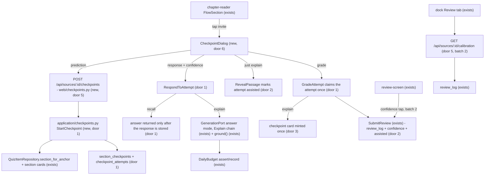
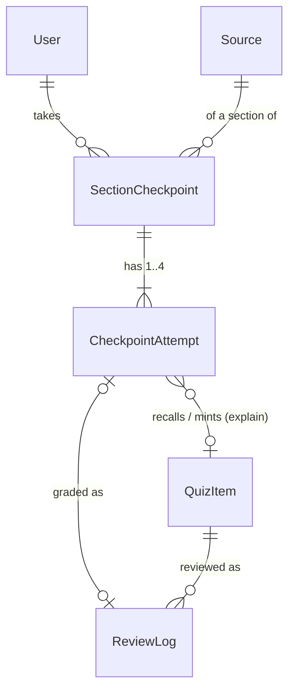

# section-checkpoint-and-calibration

## Problem

A learner who finishes a section of a book in Learny is never asked to retrieve it. The reader moves straight on (`ChapterNav`, `frontend/app/components/toc-panel.tsx:146`), retrieval happens only when a card is already due, and nothing records whether a success was earned unaided. `review_log` (`backend/app/infrastructure/db/metadata.py:610`) stores a rating and a time, so a card passed right after the tutor explained it is indistinguishable from an unaided recall. Learny also never asks how sure the learner was, so it cannot tell them when they are overconfident.

The research names the cost. Practice testing is one of only two techniques rated high-utility (testing effect g = 0.61), self-explanation reaches g = 0.55 and explain-back g = 0.56. In Bastani et al., answer-giving AI cost 17% on the unassisted exam while hint-only AI removed that harm. Calibration is trainable (56-study meta-analysis), and a judgment of learning made after retrieval improves learning (`docs/research/2026-09-30/synthesis.md`, "Learning science says a study home must withhold answers…"). The next roadmap row, `honest-mastery-map`, has to count only unassisted, spaced successes, and it cannot start until each attempt records whether it was assisted. The source gives no usage data. No learner has been observed.

When this ships, each finished section ends in an optional checkpoint. The learner first predicts how much they can recall. They then retrieve the section's cards unaided, each with a one-tap confidence rating, and explain the section in their own words. Feedback on the explanation quotes the passage and never grades it. FSRS schedules every attempt, and each review records its confidence and whether it was assisted. A per-book calibration view shows how often the learner recalled what they felt sure of.

## Flow

Reuses `SubmitReview` (FSRS advance, append-only `review_log`, study-day credit) for every grade, `QuizItemRepository.section_for_anchor` for a section's chunks, the existing `GenerationPort` in answer mode on the house Explain chain (`get_explain_generation`) with `ground()` for citations, `DailyBudget` the way card suggestions use it (AD-341), and `readable_source` for ownership including the shared sample.

## Impact

| Front | What changes |
| --- | --- |
| domain | new term: `checkpoint`. The optional end-of-section loop for one section of one source, owned by one learner. Lives in `application/checkpoints.py` |
| domain | new term: `attempt`. One retrieval inside a checkpoint, of kind `recall` (an existing card) or `explain` (an explanation of the section). Has states created → responded → graded, with an optional reveal before responding on `explain` |
| domain | new term: `confidence`. The learner's one-tap rating of an attempt before its answer is shown: 1 not sure, 2 fairly sure, 3 sure |
| domain | new term: `assisted`. A grade earned after the answer or passage was shown before the attempt. Lives on `review_log`. NULL means "not recorded" and covers every row written before this change |
| domain | new term: `prediction`. A judgment of learning made before any attempt: 1 little, 2 some, 3 most, or skipped |
| domain | existing term: `QuizItemOrigin` gains `checkpoint`. Branches on origin today: `QuizItemRepository.upsert` (conflict target per origin), `ReconcileQuizItems` (all origins), the review/quiz views, `test_domain_quiz`. A `checkpoint` card matches no partial unique, so it is a plain insert like `note` |
| existing backend | `SubmitReview.__call__` gains a required `assisted` and an optional `confidence`. Callers today: `web/quiz.py:submit_review` and tests |
| existing backend | `ReviewLogEntry` gains `confidence` and `assisted`. `append_log` writes them |
| existing UI | `FlowSection` gets a trailing invitation row. In batch 2, `ReviewCard` gets three confidence-reveal buttons beside "Reveal answer" and the dock Review tab gets a calibration block |
| existing generation | no adapter or prompt changes. Explain-back uses answer mode with a frozen application-owned message, so the `pt-br-interface` changes to the port do not collide |
| stored data | nothing to migrate. Two new tables. Three nullable columns on `review_log`, NULL on existing rows. A new origin value in a `text` column that has no CHECK |

## Relations

One-way constraints:

- A checkpoint is deleted with its user or its source (door 1).
- An attempt is deleted with its checkpoint (door 1).
- An attempt's card link and review-log link are severed, never cascaded, when the card or log row goes (door 1).
- A checkpoint has at most 3 `recall` attempts and exactly 1 `explain` attempt (door 1).
- An attempt is graded at most once (door 1).
- A `checkpoint` card has no uniqueness index (door 3).

No columns and no types here.

## Surface

| Route | In | Out | Status |
| --- | --- | --- | --- |
| `POST /api/sources/{source_id}/checkpoints` | `anchor`, `prediction` (1·2·3·null) | `checkpoint_id` · `section_title` · `anchor` · `attempts[]` of `{attempt_id, kind, question}`, no answers | `201`, `401`, `403`, `404`, `422` |
| `POST /api/checkpoint-attempts/{attempt_id}/response` | `response` (≤4000 chars, may be empty), `confidence` (1·2·3) | recall: `answer` · `source_excerpt` · `anchor` · `section_path`; explain: `feedback` · `citations[]` of `{anchor, section_path, quote}` | `200`, `401`, `403`, `404`, `409`, `422`, `429`, `503` |
| `POST /api/checkpoint-attempts/{attempt_id}/reveal` | none | `passage` · `anchor` · `section_path` | `200`, `401`, `403`, `404`, `409` |
| `POST /api/checkpoint-attempts/{attempt_id}/grade` | `rating` (recall 1–4, explain 1–3) | `quiz_item_id` · `due` · `state` | `200`, `401`, `403`, `404`, `409`, `422` |
| `POST /api/quiz-items/{item_id}/reviews` (adds fields, batch 2) | existing + optional `confidence` (1·2·3), optional `assisted` (default false) | unchanged | `200`, `401`, `403`, `404`, `409`, `422` |
| `GET /api/sources/{source_id}/calibration` (batch 2) | session cookie | `levels[]` of `{confidence, attempts, recalled}` (always 3 rows) | `200`, `401`, `404` |

## Landing

| One-way door | Literal shape | Alternative rejected |
| --- | --- | --- |
| 1. Checkpoint storage | `section_checkpoints`: `id` uuid PK, `user_id` FK users CASCADE, `source_id` FK sources CASCADE, `anchor` text, `section_title` text, `prediction` smallint NULL CHECK 1..3, `created_at`. `checkpoint_attempts`: `id` uuid PK, `checkpoint_id` FK CASCADE, `kind` text CHECK in (`recall`,`explain`), `position` smallint, `quiz_item_id` FK quiz_items SET NULL NULL, `response` text NULL, `confidence` smallint NULL CHECK 1..3, `revealed_at`, `responded_at`, `graded_at` timestamptz NULL, `feedback` text NULL, `feedback_citations` jsonb NOT NULL default `[]`, `review_log_id` FK review_log SET NULL NULL, UNIQUE (`checkpoint_id`, `position`). Once-only transitions are conditional UPDATEs (`… WHERE responded_at IS NULL`, `… WHERE graded_at IS NULL AND responded_at IS NOT NULL`) | One table with checkpoint-level explanation columns: it cannot represent several recall attempts without a second shape. Keeping state client-side: then the server cannot refuse to reveal an answer before an attempt exists, and "no answer before the attempt" would be a UI promise rather than an API guarantee |
| 2. Assistance and confidence on the review record | `review_log.confidence` smallint NULL CHECK 1..3, `review_log.assisted` boolean NULL (NULL = pre-cycle, not recorded), `SubmitReview(assisted: bool, confidence: int \| None = None)` with `assisted` keyword-required. An explain attempt is assisted iff `revealed_at IS NOT NULL` when graded, decided server-side. A recall attempt is always `assisted=false` | A separate attempts ledger for reviews: two sources of truth for row 7, and undo would have to reach both. `assisted NOT NULL DEFAULT false`: labels years of unknown history as unaided, which is the exact illusion row 7 exists to avoid. A client-sent `assisted` on checkpoint grades: the server already knows whether it revealed the passage |
| 3. `checkpoint` card origin | `QuizItemOrigin.CHECKPOINT = "checkpoint"`, `item_type=free_recall`, question `Explain "{title}" in your own words.`, `user_id` set explicitly (the shared sample's source is owned by the operator), reused when the caller already has an active checkpoint card on (source, anchor), with no partial unique index | A partial unique on (`user_id`,`source_id`,`anchor`): re-ingest reconciliation relocates anchors (AD-078), and two cards moved onto one anchor would make ingestion raise. Minting only on a miss: a well-explained section would then never come back spaced, so row 7 would get no spaced unaided successes for it |
| 4. Explain-back through the answer port | mode `answer`, frozen `EXPLAIN_BACK_MESSAGE` in `application/checkpoints.py`, evidence = the section's chunks ordered least-covered first (application-owned lexical overlap), capped at 6, house Explain chain, USD-only debit (`KIND_GENERATION`). A raise or not-found falls back to quoting the least-covered chunk | A new `MODE_EXPLAIN_BACK`: it touches every adapter and the routing chain, which `pt-br-interface` is editing in parallel, and the deterministic adapter would need new prose logic (AD-300 keeps it extractive). A dedicated judge port: a new seam for one prompt. The brief requires the existing ports |
| 5. Route shapes | the four checkpoint routes above under `/api/sources/{id}/checkpoints` and `/api/checkpoint-attempts/{id}/…`, plus `GET /api/sources/{id}/calibration`. All POSTs take `rate_limit_quiz` + origin + CSRF | Nesting attempts under `/api/checkpoints/{id}/attempts/{id}`: an attempt id is already globally unique and owned through its checkpoint, so the extra segment adds nothing a caller can use |
| 6. Confidence vocabulary in the UI | three one-tap buttons: `Not sure` (1) · `Fairly sure` (2) · `Sure` (3). On review cards they reveal the answer. Prediction is `Little` · `Some` · `Most`. Explain-back self-assessment is `Missed it` (1) · `Partly` (2) · `Got it` (3), mapped to FSRS Again/Hard/Good | A 0–100 slider: slower than one tap, and it reads as a score. Four levels: no evidence that a fourth bin helps, and three keeps the calibration table small at low volume |

- Nothing else in this change is hard to reverse.

## Criteria

Batch 1 is S1–S5, the checkpoint flow with assisted recording and FSRS. Batch 2 is S6–S7, confidence on review grades and the calibration view.

### S1: The reader offers a checkpoint at the end of a section (P1)

The learner sees an optional "check yourself" invitation after a section they read, and reading never stops for it.

**Acceptance Criteria**

1. WHILE a chapter is open, the reader SHALL render a checkpoint invitation after every section whose `word_count` is at least 150, and none after a shorter section.
2. The invitation SHALL be an inline row after the section body that opens nothing until tapped, so scrolling and reading continue without interacting with it.
3. WHEN the learner taps the invitation THEN the system SHALL open the checkpoint dialog at the prediction step for that section's anchor.
4. WHEN the learner closes the dialog at any step THEN the reader SHALL show the same chapter at the same position, and grades already submitted SHALL stay saved.

**Independent test:** open a chapter with a long and a short section, see one invitation, tap it, close the dialog.

### S2: Predict, then retrieve unaided with a confidence tap (P1)

The learner predicts, then recalls each of the section's cards before seeing any answer.

**Acceptance Criteria**

5. The prediction step SHALL offer `Little`, `Some`, `Most` and `Skip`, and WHEN the learner picks one THEN the system SHALL create the checkpoint with `prediction` 1, 2, 3 or null respectively.
6. WHEN a checkpoint is created for an anchor THEN the response SHALL list up to 3 `recall` attempts, one per active, unflagged, non-`checkpoint` card the caller owns whose anchor equals the section's canonical anchor, ordered by due ascending then id, followed by exactly one `explain` attempt.
7. The create response, and the response of every route called before an attempt's response is recorded, SHALL contain no card answer, source excerpt or passage text for that attempt.
8. IF the source is not readable by the caller, or the anchor resolves to no section of it, THEN create SHALL return 404 and persist nothing.
9. WHEN a `recall` response (0–4000 characters, where empty means "I don't remember") is submitted with `confidence` 1–3 THEN the system SHALL store both and return the card's answer, source excerpt, anchor and section path.
10. IF a response is submitted to an attempt that already has one THEN the system SHALL return 409 and leave the stored response and confidence unchanged.
11. IF `confidence` is absent or outside 1–3, or `response` exceeds 4000 characters, THEN the system SHALL return 422 and store nothing.
12. IF the attempt does not exist or belongs to another learner's checkpoint THEN every attempt route SHALL return 404.
13. The recall step SHALL show the question and an input with the confidence buttons as the only way to submit, and SHALL show the answer only after that submit returns.

**Independent test:** create a checkpoint on a section with two cards and assert the payload has no answers. Respond to one card, then assert that answer appears.

### S3: Every attempt is scheduled by FSRS (P1)

Recall attempts and the explanation go into FSRS through the existing review path, so what was missed comes back soon.

**Acceptance Criteria**

14. WHEN a responded `recall` attempt is graded with rating 1–4 THEN the system SHALL advance that card's FSRS schedule through `SubmitReview`, append exactly one `review_log` row carrying the rating, the attempt's stored confidence and `assisted=false`, and credit one review to the study day.
15. IF an attempt with no recorded response is graded THEN the system SHALL return 409 and append no `review_log` row.
16. WHEN the same attempt is graded twice, sequentially or concurrently, THEN exactly one `review_log` row SHALL exist for it and the other request SHALL receive 409.
17. WHEN the `explain` attempt is graded with 1 (`Missed it`), 2 (`Partly`) or 3 (`Got it`) THEN the system SHALL review the caller's `checkpoint` card for that source and anchor with that rating, minting one first when the caller has no active one, and SHALL return its `quiz_item_id`.
18. IF the `explain` attempt is graded with 4 THEN the system SHALL return 422.
19. WHEN a `checkpoint` card is minted THEN it SHALL be `origin=checkpoint`, `free_recall`, `user_id` the caller, with the section's anchor and path and question `Explain "<section title>" in your own words.` Its answer and `source_excerpt` SHALL be the first passage the feedback quoted, else the section's first chunk, cut to `quiz_max_card_chars`, and it SHALL get `SchedulingPort.initial()` scheduling.
20. WHEN the caller already has an active `checkpoint` card for that source and anchor THEN grading the `explain` attempt SHALL review that card and SHALL NOT mint a second one or rewrite its text.

**Independent test:** grade a recall attempt `Again` and see the card due within minutes. Grade the explanation `Missed it` and see a new `checkpoint` card in the due queue.

### S4: Explain-back gets formative feedback that quotes the passage (P1)

The learner explains the section from memory. Feedback says what the passage holds that the explanation left out, quoted and cited, never scored.

**Acceptance Criteria**

21. WHEN a non-blank `explain` response is submitted with `confidence` 1–3 THEN the system SHALL call the generation port exactly once in answer mode, with the section's chunks (at most 6) as evidence ordered by fewest words shared with the response first, and SHALL return `feedback` plus only those citations that `ground()` keeps.
22. The `explain` response payload and the dialog SHALL contain no score, grade, percentage, pass/fail or verdict field or wording.
23. IF the generation port returns not-found, raises, or keeps no citation after grounding THEN the system SHALL return 200 with fallback feedback quoting the least-covered chunk verbatim as the single citation; a raise SHALL debit nothing, and a completed call SHALL debit its usage as AC 26 does.
24. IF the `explain` response is blank THEN the system SHALL NOT call the generation port and SHALL return the least-covered chunk as the quoted passage.
25. IF the caller's daily AI budget is exhausted THEN the `explain` response SHALL return 429, and IF AI is paused THEN 503, storing nothing in either case.
26. WHEN a provider call completes THEN the system SHALL debit its reported usage to the caller's UTC day as `KIND_GENERATION` (USD only), in the same transaction that stores the response.
27. WHEN feedback is shown THEN the dialog SHALL render each citation as the quoted passage with its section path, then the `Missed it` · `Partly` · `Got it` self-assessment.

**Independent test:** with the deterministic adapter, submit an explanation that echoes chunk A only, and see the feedback quote chunk B first.

### S5: Assisted attempts are recorded as assisted (P1)

"Just explain" stays one tap away, never the default, and anything earned after it is marked assisted, so row 7 can exclude it.

**Acceptance Criteria**

28. WHILE the `explain` attempt has no response, the dialog SHALL show `Just explain` as a secondary text action and the explanation input with its confidence buttons as the primary path.
29. WHEN `Just explain` is used before a response THEN the system SHALL stamp the attempt revealed and return the section's first chunk as the passage.
30. IF `reveal` is called on an attempt that already has a response, or on a `recall` attempt, THEN the system SHALL return 409 and change nothing.
31. WHEN a revealed `explain` attempt is graded THEN its `review_log` row SHALL store `assisted=true`, and WHEN an unrevealed one is graded THEN `assisted=false`.
32. The system SHALL write a non-null `assisted` on every `review_log` row appended after this change. Rows that already exist keep NULL.

**Independent test:** reveal, explain, grade `Got it`, and read `assisted=true` on the log row. Repeat without reveal and read `false`.

### S6: Review grades capture confidence (P2, batch 2)

A normal review can carry a confidence tap without making it mandatory.

**Acceptance Criteria**

33. WHILE a review card's answer is hidden, the review screen SHALL show `Not sure`, `Fairly sure` and `Sure` buttons that each reveal the answer, next to the existing `Reveal answer` button, which reveals without confidence.
34. WHEN a card revealed through a confidence button is graded THEN the review request SHALL carry that `confidence`, and WHEN it was revealed through `Reveal answer` or Space THEN the request SHALL omit `confidence`.
35. WHEN `POST /api/quiz-items/{id}/reviews` receives `confidence` 1–3 or no `confidence` THEN the `review_log` row SHALL store that value or NULL, and IF `confidence` is outside 1–3 THEN the system SHALL return 422.
36. WHEN the learner opened the card editor (which shows the answer) before revealing the card THEN its grade SHALL be sent with `assisted=true`, otherwise `assisted=false`.

**Independent test:** tap `Sure`, grade `Good`, and read `confidence=3, assisted=false` on the log row.

### S7: A per-book calibration view (P2, batch 2)

The learner sees how often they recalled what they felt sure of, per book.

**Acceptance Criteria**

37. WHEN `GET /api/sources/{id}/calibration` is called by a learner who can read the source THEN the system SHALL return exactly three rows, for confidence 1, 2 and 3. Each row SHALL count the caller's `review_log` rows on that source's cards with that confidence, `assisted=false` and not undone, and how many of them had a rating of 2 or more.
38. IF the source is not readable by the caller THEN calibration SHALL return 404.
39. The calibration SHALL never include another learner's reviews, including on the shared sample.
40. The reader dock's Review tab SHALL show one line per confidence level that has attempts, in the form "When you felt Sure, you recalled 8 of 10", and no overall score.
41. IF no attempt on the book has a confidence THEN the Review tab SHALL show an empty state that says confidence taps during review and checkpoints fill this in.

**Independent test:** grade three cards with different confidences and see three lines with the right counts.

## Out of scope

| Excluded | Why |
| --- | --- |
| Pretest when a section is first opened (rq02 move 3) | Friction at the moment of curiosity, and the brief places the prediction inside the end-of-section checkpoint |
| Answer-before-attempt flows, multiple choice, a second scheduler | Brief non-goals. ADR-0021 holds |
| Grading explain-back automatically, or showing a score | MEC rates automatic grading high-risk. The AI feedback is formative and the learner self-assesses |
| The mastery map and counting successes (row 7) | Next row. This one only records the signal |
| Recording tutor check passes as attempts | It would mean changes inside the frozen teach playbook. Tutor passes are assisted by construction |
| Streaks, XP, badges | Do-not-build list |
| Confidence driving FSRS | rq02 move 7: a judgment of learning is a different construct and would poison the scheduler |
| Persisting "skip" or hiding invitations per section | Skipping means not tapping, and nothing is stored |
| Interleaved contrast items, pt-BR copy | Other rows. Copy goes through the catalog if `pt-br-interface` lands first |

## Assumptions

| Assumption | Chosen default | Rationale | Confirmed? |
| --- | --- | --- | --- |
| What "prediction prompt" means | A judgment of learning at the start of the checkpoint ("how much can you recall?"), not a pretest before reading | The brief orders it inside the end-of-section checkpoint. rq02 move 7 (predict-then-reveal JOLs) is cited by the row and feeds calibration | n |
| Mint a checkpoint card on every graded explanation, not only on a miss | Always mint (reuse if one exists), rated by the self-assessment | FSRS must space a well-explained section too, or row 7 has nothing spaced to count. A miss comes back within minutes as Again | n |
| Who decides explain-back correctness | The learner's self-assessment after reading the feedback. The AI only writes formative feedback | Keeps automatic grading out (MEC). Mirrors the review screen's honest self-grade | n |
| What counts as "recalled" in calibration | FSRS pass, rating ≥ 2 | One rule for cards and explanations, and Again is FSRS's only lapse | n |
| Calibration population | Only `assisted=false`, not undone, with a confidence | Confidence after seeing the answer measures nothing. Undone grades never happened | n |
| Invitation threshold | 150 words | Below that a section is a heading stub, and inviting there is noise. It is a frontend constant, so changing it is reversible | n |
| Which recall cards | Up to 3 of the caller's active, unflagged cards on the exact anchor, due-first, excluding `checkpoint` cards | Research template asks for 3–5 items. Due-first serves FSRS. A checkpoint card is what the explanation reviews | n |
| Early review of a not-yet-due card in a checkpoint | Allowed, through `SubmitReview` as today (A-4) | It is a real unaided retrieval, and the existing review path already permits cramming | n |
| Explain-back generation chain | House Explain chain, not the learner's chosen profile | AD-351 scopes the preference to Ask/Teach turns. The Explain chain is the house cost lever (AD-345) | n |
| Feedback language | Whatever the generation port produces today. `pt-br-interface` adds the response-language seam | Whichever of the two merges second adapts | n |
| Judged real-provider quality of the feedback | Not evaluated this cycle | The CI Anthropic key is unfunded (D5). A funded run should judge `EXPLAIN_BACK_MESSAGE` output for grounding and "no grade" wording | n |
| Migration number (resume, 2026-10-11) | `0031_section_checkpoints`, revising `0030_user_provider_credentials` | PR #76 landed 0030 on `main` while this branch was paused; renumbering keeps one Alembic head. The tables and columns are unchanged | n |
| Rebase before Verifier round 2 (resume, 2026-10-11) | Rebase on `main` first, then run the gates and the Verifier once, on the code that ships | Verifying before the rebase would verify a migration chain that cannot merge; the rebase touched only metadata, the migration file and its test | n |
| Manual stack pass and screenshots (resume, 2026-10-11) | Deferred to the owner, recorded in the PR body | The overnight lane runs without a per-lane Compose stack (memory budget); the flow is pinned by component and HTTP tests | n |

**Open questions:**

| # | Kind | Question | Until answered |
| --- | --- | --- | --- |
| 1 | blocks go-live | A funded judged run of explain-back feedback on a real provider | Feedback quality on Anthropic is unmeasured. The offline path is pinned by tests |

## Observable

| Surface | Decision | Landing |
| --- | --- | --- |
| screen checkpoint dialog | empty state (section with no cards) | AC 6 (zero recall attempts, explain only) |
| screen checkpoint dialog | loading state | AC 13 (answer appears only after submit returns); buttons disabled while pending |
| screen checkpoint dialog | error state | AC 23–25 (fallback feedback; budget/pause copy from the existing error text) |
| screen checkpoint dialog | unauthorised state | existing - the reader's `onRequireAuth` 401 path |
| screen checkpoint dialog | density and ordering | AC 6, 27 |
| screen checkpoint dialog | destructive action confirms | n/a - nothing is deleted; closing keeps what was graded (AC 4) |
| screen reader invitation | empty, loading, error | AC 1 (absent under 150 words); n/a otherwise - it is static until tapped |
| screen review card confidence | all states | AC 33–34; error and loading existing - the review screen's submit error path |
| screen dock calibration | empty state | AC 41 |
| screen dock calibration | loading and error state | existing - the dock tab's skeleton and inline error pattern |
| screen dock calibration | ordering | AC 40 (Not sure → Sure) |
| API all new routes | error shape and codes | AC 8, 10–12, 15–16, 18, 25, 30, 38. The existing `{detail}` shape |
| API all new routes | who may call | AC 8, 12, 38–39 |
| API all new POST routes | rate limits | existing - `rate_limit_quiz` + origin + CSRF, as on the review routes |
| API all new routes | versioning | n/a - the frontend is the only consumer and ships in the same PR |
| copy checkpoint dialog | tone and what the reader does next | AC 22, 27, 28 |

## Sources

- `.specs/project/ROADMAP.md` `## v8` row `section-checkpoint-and-calibration` - the binding scope line
- `docs/research/2026-09-30/synthesis.md` row detail #6 and the do-not-build list - the non-goals
- `docs/research/2026-09-30/harness/synthesis.md` D1–D6 - process

## Deviations from lean

- Verifier per batch (D2). Batch 1 is verified over C1–C(S5) before its PR. Batch 2 is verified in full before the last PR.
- Commits carry `Assisted-by: Claude Code` (D3), overriding `references/build.md`.
- The door gate is self-answered under the owner's 2026-10-02 policy (decide autonomously, record why). The assumptions above are that record.

## Amendments

- AC 23 / C23 (during build, before any test was green): the first draft debited nothing on every fallback. That was wrong. A not-found or ungrounded reply is a completed provider call that cost money, and the conversation path debits completed calls too. Leaving it free would also make the fallback a way to spend unmetered. Now only a raise debits nothing.
